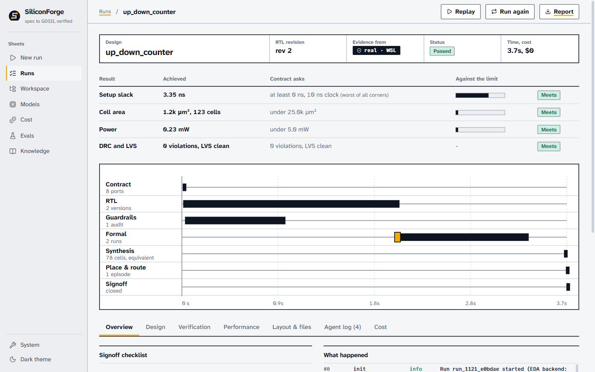
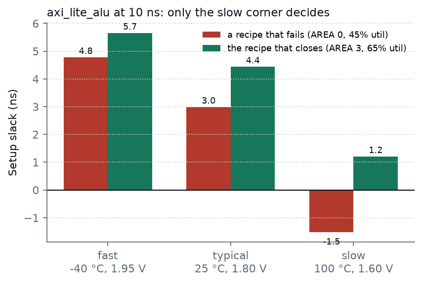
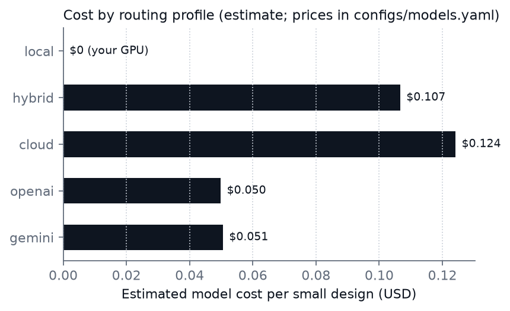

<div align="center">


# SiliconForge

**Describe a chip block. Get RTL that is formally proven, checked for equivalence, and laid out on real open-source EDA.**

A local-first agent where tools, not language models, decide what passes. Desktop app, web cockpit, terminal, and an agent that works in your own folder.

[](https://github.com/PundarikakshNTripathi/silicon-forge/actions/workflows/ci.yml)
[](LICENSE)


<br>



<sub>A real run on real tools. The amber square marks the moment formal verification sent the design back for repair.</sub>

[What it does](#what-it-does) · [Results](#results) · [Real or simulated](#what-is-real-and-what-is-simulated) · [Quickstart](#quickstart) · [Beyond the pipeline](#beyond-the-pipeline) · [Architecture](#architecture) · [Benchmarks](#benchmarks) · [Learn](docs/learning/roadmap.md)

</div>

---

## What it does

You write a spec in plain language. SiliconForge turns it into a machine-checked **design contract**, asks a model for the SystemVerilog, and then refuses to believe it until tools agree.

| Step | What decides | Tool |
| :--- | :--- | :--- |
| 1. Guardrails | invented ports, cells, flags, unsynthesizable code are rejected | rules + Verilator |
| 2. Formal | tries to break the design; a cover check stops proofs passing vacuously | SymbiYosys (BMC, PDR) |
| 3. Repair | only the failing cone of logic goes back to the model | counterexample slicing |
| 4. Equivalence | the synthesized netlist must equal the RTL | Yosys `equiv_*` |
| 5. Layout | an RL and Pareto search over recipes, across real timing corners | LibreLane / OpenROAD |
| 6. Signoff | timing, DRC, LVS, equivalence and budgets, then the GDSII | all of the above |

<p align="center"></p>

Every result carries where it came from: a **solid ink stamp** means a real tool produced it, a **hatched outline** means a surrogate did. The distinction survives greyscale.

## Results

**A real bug, found and fixed by real tools.** On the `up_down_counter` example the first RTL ignores `load` while counting. SymbiYosys produces a counterexample, the failing cone of logic goes back to the model, the repaired RTL is proven, Yosys proves equivalence (78 cells), and LibreLane produces a GDSII: worst-corner slack **+3.35 ns**, 1166 µm², 0.23 mW, DRC 0, LVS clean.

<table>
<tr>
<td width="58%"></td>
<td width="42%"></td>
</tr>
<tr>
<td><sub>The counterexample SymbiYosys produced. The shaded cycle is where the assertion failed.</sub></td>
<td><sub>The layout LibreLane produced, rendered from the real GDSII.</sub></td>
</tr>
</table>

**It signs off on the corner that matters, and searches for a layout that survives it.** The 32-bit `axi_lite_alu` meets 10 ns at the typical corner with almost any recipe, but **8 of 9 layout recipes miss it at the slow corner (by 1.3 to 3.2 ns)**. SiliconForge signs off on the worst corner by default; its optimizer found the one recipe that closes everywhere, after which all 8 signoff checks passed: slack **+1.13 ns**, 8682 µm², 0.93 mW, DRC 0, LVS clean, equivalence proven.

<table>
<tr>
<td width="50%"></td>
<td width="50%"></td>
</tr>
</table>

**It reports its own gaps.** A mutation run on the worked example's own tests killed 34 planted bugs, proved 6 mutants equivalent, and listed the 4 that survived, each with its line and the exact change: three sit on one reset line whose values the tests never check, and one is a write guard no test exercises. See [Beyond the pipeline](#beyond-the-pipeline).

## What is real and what is simulated

| Capability | Status |
| :--- | :--- |
| Formal verification (BMC, PDR proof, cover), counterexample traces | **Real**: SymbiYosys + Bitwuzla, all 4 example designs, good and buggy |
| Logical equivalence (RTL vs synthesized netlist) | **Real**: Yosys `equiv_*` |
| Place and route, GDSII, per-corner PPA | **Real**: LibreLane 3.0 / OpenROAD on Sky130, WSL2 or native |
| Verification toolkit (lockstep, mutation, coverage, decoders) | **Real**: Icarus + cocotb, Yosys; needs a real backend and refuses the simulated one |
| Tiny Tapeout IHP: synthesis, tile budget, gate-level simulation | **Real**: Yosys against the real IHP liberty, PDK cell models in Icarus |
| Tiny Tapeout IHP: hardening, timing, DRC, precheck | **Not run locally.** Needs the official flow (Docker, or the GitHub `gds` workflow) |
| Model inference | **Real**: llama.cpp, Claude (official SDK), OpenAI-compatible, Gemini through the Antigravity CLI |
| `simulated` backend | **Surrogate models**, always labelled. For demos and CI only |
| Docker backend, subscription CLI bridges (Claude, Codex, Gemini) | Wiring is unit-tested; not run end to end on the reference machine |
| GPU benchmark of local models | **Pending**: the GPU was occupied by another project; see [Benchmarks](#benchmarks) |

Free-form specs need a model. The bundled-examples profile deliberately fails on unknown specs rather than returning someone else's design.

## Quickstart

```bash
git clone https://github.com/PundarikakshNTripathi/silicon-forge && cd silicon-forge
uv venv --python 3.12 .venv && source .venv/bin/activate          # Windows: .venv\Scripts\activate
uv pip install -e ".[api,providers,tui,mcp,dev]"

siliconforge run --spec hardware/examples/axi_lite_alu/spec.md --backend simulated --inject-bug   # offline, free

cd services/dashboard && pnpm install && pnpm build && cd ../..
siliconforge serve                                                 # http://127.0.0.1:8000
```

For real results install the EDA tools once (about 15 minutes, no root): [docs/eda-setup.md](docs/eda-setup.md), then add `--backend wsl` (Windows) or `--backend native`.

<details>
<summary><b>Work in your own folder with the agent</b></summary>

```bash
cd my-chip
siliconforge init . --profile dev --backend wsl     # writes siliconforge.yaml (optional)
siliconforge chat                                   # like Claude Code or Codex, but it knows chip tools
siliconforge agent --mode auto "add a synchronous reset to rtl/cnt.sv and prove it"
```

In the desktop app and web cockpit, the **Workspace** page has a folder picker, a file tree and the same conversation, with approval prompts for edits and commands. [docs/workspaces.md](docs/workspaces.md)
</details>

<details>
<summary><b>A local model on your GPU</b></summary>

```bash
siliconforge models detect                      # what is on this machine, and who is using the GPU
siliconforge models install
siliconforge models pull --repo unsloth/Qwen3.5-9B-GGUF --file Qwen3.5-9B-Q4_K_M.gguf
siliconforge models start --path <any .gguf>    # refuses if another program holds the VRAM; never evicts it
siliconforge run --spec my_spec.md --profile local --backend wsl
```
</details>

<details>
<summary><b>Claude, OpenAI, Gemini, or a subscription you already have</b></summary>

Save a key on the **Models** page (OS keychain) or set `ANTHROPIC_API_KEY` / `OPENAI_API_KEY` / `GEMINI_API_KEY`, then choose `--profile cloud | openai | gemini | hybrid`. Opt-in CLI bridges (`claude`, `codex`, `gemini`, and **Gemini 3.8 Flash through the Antigravity CLI**) never touch your sign-in tokens; see the [terms note](docs/providers.md#subscription-cli-bridge-opt-in).
</details>

<details>
<summary><b>Desktop app, terminal UI, and other coding agents</b></summary>

```bash
python scripts/build_desktop.py          # UI + C++ engine + frozen backend + Electron installer
siliconforge tui                         # terminal UI
claude mcp add siliconforge -- python -m services.orchestrator.mcp_server
```
MCP tools: `lint_rtl`, `verify_rtl`, `check_equivalence`, `retrieve_skill`, `run_example`, `isa_check`, `run_cocotb`, `mutation_test`. Harness files for Claude Code, Codex, Antigravity, opencode, Cursor and others point to [AGENTS.md](AGENTS.md).


</details>

## Beyond the pipeline

### An agent that works in your folder

Pick any folder. The agent reads and writes only there, follows its `SILICONFORGE.md` or `AGENTS.md`, and has typed tools for the ISA toolchain, simulation, mutation testing and Tiny Tapeout synthesis. Permission modes follow Claude Code (ask, accept-edits, auto, plan). A workspace can **enforce** a model policy: the router drops every model it does not allow, and an empty chain is an error, not a fallback. Every call is recorded (metadata and a prompt hash, never prompt text), and `siliconforge report ai-usage` turns the ledger into a disclosure document. [docs/workspaces.md](docs/workspaces.md)

### One file defines the processor

Write an instruction set once in `isa.yaml`. SiliconForge generates a Verilog decoder (proved one-hot with SymbiYosys), an assembler with line-numbered errors, a golden model, bit-field documentation, and a **timing checker that proves cycle gaps between pin events from the control-flow graph**. Overlapping encodings are rejected at load. [docs/isa-toolchain.md](docs/isa-toolchain.md)

### Evidence for how well something is verified

| Tool | Answers | Worked example (`hardware/isa/pio16`, real tools) |
| :--- | :--- | :--- |
| Lockstep co-simulation | does the RTL match the model after *every* instruction? | 9 cocotb tests, 3 seeds, 91.7% functional coverage; a planted `djnz` bug fails it and names the register |
| Mutation testing | would the tests notice a planted bug? | **89.5%** (34 killed, 4 survived, 6 proven equivalent and excluded); survivors listed by line |
| Independent decoders | does the pin behaviour really speak UART/SPI/I2C/WS2812? | 10 UART bit gaps proven exactly 16 cycles |
| Toggle and functional coverage | which behaviour did the tests never reach? | reported, with what it does not measure |

<p align="center"></p>

[docs/verification.md](docs/verification.md)

### Tiny Tapeout on IHP, with real numbers and honest limits

```bash
siliconforge tt scaffold my-chip --top tt_um_you_chip --tiles 4x4
siliconforge tt check --synth     # info.yaml, ports, reset, latches, area against the tile budget
siliconforge tt gls               # your cocotb tests on the gate-level netlist, PDK cell models
```

Synthesis runs against the **real IHP liberty**, so area is measured, not guessed: the `pio16` teaching engine is 1,723 cells and 43,544 µm², **63% of it flip-flops**, which is exactly the kind of fact that decides an architecture on day one. Timing, DRC and the official precheck need the official flow; the tool says so instead of implying a pass. [docs/tiny-tapeout.md](docs/tiny-tapeout.md)

### Local models without fighting other projects

SiliconForge starts its own `llama-server`, checks free VRAM first, and **refuses with options rather than evicting** another program's job. `siliconforge models detect` lists models already on the machine (your Hugging Face cache is used in place) and other servers it found, labelled as someone else's.

## Architecture

<p align="center"></p>

More in [ARCHITECTURE.md](ARCHITECTURE.md). Contest workflow:

<p align="center"></p>

## Guardrail gates

| Gate | Catches | How |
| :--- | :--- | :--- |
| 1 Port contract | missing or renamed ports, wrong directions or widths | contract check against the RTL header |
| 2 Lint | `#delay`, `initial`, blocking/non-blocking misuse, latch risk | C++ `sf-telemetry` (Python fallback) + Verilator |
| 3 PDK cells | invented standard cells | allowlist from `configs/pdks/` |
| 4 Flow variables | made-up LibreLane variables, commercial-tool Tcl, impossible clocks | allowlist validated against the real LibreLane source |
| 5 Formal vacuity | properties on signals that do not exist, unreachable covers | grounding check + cover result |
| 6 Equivalence | netlist that differs from the RTL | Yosys `equiv_make/simple/induct` |

Gates 1 and 2 use pattern matching, not a full SystemVerilog parser (a `pyslang` front end is on the roadmap).

## Formal verification, layout, and inference

<details>
<summary><b>The formal loop</b></summary>

The formal agent never writes SVA. It emits a **typed property IR** (reset values, invariants, handshake stability, mutual exclusion, combinational equivalence, latency bounds, cover) which a deterministic compiler lowers to assertions. SymbiYosys runs `bmc` (Bitwuzla), `prove` (`abc pdr`) and `cover`. On failure the real VCD is distilled into the failing property, cycle and stimulus, the failing signal's backward cone of influence is sliced from the RTL, and only that slice goes back for repair. This follows the contract-first and slicing ideas in [Veri-Sure](https://arxiv.org/abs/2601.19747).
</details>

<details>
<summary><b>Place and route and PPA optimization</b></summary>

LibreLane runs the classic flow on Sky130 and metrics come from its `metrics.json` (per-corner setup slack, area, power, DRC, LVS) beside the real GDSII and a layout render. A clipped-PPO-style policy with UCB exploration and a Pareto archive chooses among recipes whose keys are real LibreLane variables. Layouts take minutes, so the optimizer runs parallel episodes, stops early once signoff closes, caches results by hash(RTL, knobs, PDK), and can try relaxed clocks. Signoff uses the **worst timing corner** by default.
</details>

<details>
<summary><b>Inference, caching and cost</b></summary>



- **Profiles** map three task tiers to ordered fallback chains: `replay`, `local`, `hybrid`, `dev`, `cloud`, `openai`, `gemini`, `gemini-agy`, `competition`, `subscription`.
- **Router**: circuit breakers, refusal fall-through, tier escalation on repeated repair failures, enforced model policy.
- **Caching, three layers**: provider and server prompt-prefix caches (stable content first), an exact-match persistent response cache, an EDA result cache.
- **Cost control**: pre-run estimate, USD / token / per-stage budgets, cache-aware pricing.
- Gemini 3.8 Flash via `agy` reports real token usage and carries about 10k tokens of agent overhead per call; details in [docs/providers.md](docs/providers.md).
</details>

## Benchmarks

Every number here comes from a file in [`benchmarks/results/`](benchmarks/results). Reproduce with `python benchmarks/bench_verification.py`, `python scripts/make_plots.py`.

| What | Result | Source |
| :--- | :--- | :--- |
| Example designs on real tools | good RTL proven and equivalent; injected bug caught with a counterexample, all 4 designs | `scripts/verify_examples.py`, `tests/test_real_eda.py` |
| `up_down_counter` end to end | slack +3.35 ns (worst corner), 1166 µm², 0.23 mW, DRC 0, LVS clean | `real-up_down_counter-*.json` |
| Lockstep + coverage (`pio16`) | 9 tests over 3 seeds pass; functional coverage 91.7% (uncovered: all-ones pin value, short delays) | `verification-pio16-*.json` |
| Mutation testing (`pio16`) | 89.5%: 34 killed, 4 survived, 6 proven equivalent | `verification-pio16-*.json` |
| Real IHP synthesis (`pio16`) | 1,723 cells, 43,544 µm², 63% sequential; smallest fitting tile 2x2 with a 1.2 margin | `verification-pio16-*.json` |
| llama.cpp prefix cache | first token 8.6x faster on a repeated prefix (CPU) | `llamacpp-prefix-cache-cpu-*.json` |
| C++ telemetry vs Python | C++ ~8 ms per spawned call, Python ~0.04 ms in-process, so no speed claim | `telemetry-*.json` |
| Local GPU model benchmark | **not yet run**: the GPU was held by another project; Qwen3.5-9B, Qwen2.5-Coder-7B and Qwen3-8B are downloaded and the harness is ready | |

## Learn the field, and see where this fits

- [**Landscape**](docs/landscape.md): how SiliconForge compares with research systems, open flows, commercial agentic EDA and public contest entries, and where each wins.
- [**Learning roadmap**](docs/learning/roadmap.md): six stages from logic to a taped-out chip, with courses, books, practice platforms and tools.
- [**Papers**](docs/learning/papers.md): annotated, every arXiv reference checked against its abstract page.

## Configuration, CLI, layout

<details>
<summary><b>Configuration files</b></summary>

| File | Purpose |
| :--- | :--- |
| `siliconforge.yaml` (in a workspace) | profile, backend, PDK, model policy |
| `configs/flow_default.yaml` | backend, PDK, iteration limits, targets, optimizer, budgets |
| `configs/models.yaml` | providers, prices (with cache pricing), routing profiles |
| `configs/pdks/*.yaml` | cell and flow-variable allowlists, clock floors |
| `configs/prompts/` | agent system prompts |
</details>

<details>
<summary><b>CLI reference</b></summary>

```text
siliconforge run     --spec FILE [--backend simulated|native|wsl|docker] [--profile P] [--workspace DIR]
siliconforge chat | agent "task"  [--workspace DIR] [--mode ask|accept-edits|auto|plan]
siliconforge init    [DIR] [--profile P] [--allow-model GLOB]
siliconforge isa     gen|asm|disasm|check|run isa.yaml [program.asm]
siliconforge verify  sim|mutate|toggle ...
siliconforge tt      scaffold|check|synth|gls|pack|doctor|harden
siliconforge report  ai-usage [--workspace DIR]
siliconforge models  detect|install|pull|start|status
siliconforge eval | doctor | serve | tui | mcp
python scripts/dev.py build-cpp|test|lint|doctor
```
</details>

<details>
<summary><b>Repository layout</b></summary>

```text
services/orchestrator/   pipeline, agent, workspace, isa, verify, tt, guardrails, EDA backends, inference, RL, API, MCP
services/telemetry_engine/  C++20 log parser and RTL linter (CMake)
services/dashboard/      React cockpit (see DESIGN.md there)
services/tui/            Textual terminal UI
apps/desktop/            Electron shell
hardware/                examples (designs) and isa (the pio16 worked example)
configs/  benchmarks/  docs/  tests/  scripts/
```
</details>

## Design decisions

- **No agent framework (LangGraph, Google ADK, Microsoft Agent Framework).** The pipeline is a deterministic graph whose edges are tool verdicts, not model routing, so a framework would add a second state model without adding capability. The workspace agent is a small loop over a JSON action protocol that every model backend can honour.
- **SymbiYosys over Lean for verification.** Push-button BMC, PDR and equivalence fit RTL. Lean-based RTL proofs ([Rtl2lean](https://arxiv.org/abs/2607.16855)) need RTL-to-Lean translation and model-written lemmas; a possible research track, not a dependency.
- **Honest defaults.** Worst-corner signoff, provenance on every result, no silent fallback, no personal data in a ledger, and the tool never submits anything for you.

## Roadmap

- `pyslang` port and lint front end
- GPU benchmark of local models and a recommended default (needs an exclusive GPU window)
- Local hardening for Tiny Tapeout through Docker, with timing and DRC read back into the report
- Persistent telemetry server so the native path pays off; Cocotb gate in the pipeline
- A release with signed installers

## Contributing

Workflow, branch names and commit style are in [CONTRIBUTING.md](CONTRIBUTING.md). If you use a coding agent, [AGENTS.md](AGENTS.md) is the single source of truth. Licensed under [Apache-2.0](LICENSE).
