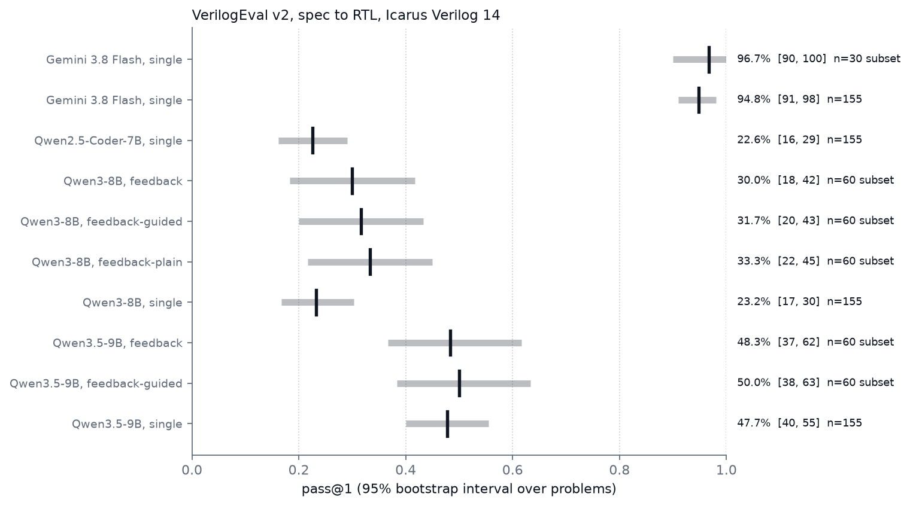

<div align="center">


# SiliconForge

**Verification-first RTL tooling on open-source EDA, with an agent that tools can overrule.**

[](https://github.com/PundarikakshNTripathi/silicon-forge/actions/workflows/ci.yml)
[](LICENSE)


<br>


<sub>A run on real tools. The amber square marks the moment formal verification sent the design back for repair.</sub>

[Status](#status) · [Quick start](#quick-start) · [What is in it](#what-is-in-it) · [Results](#results) · [Limits](#limits) · [Architecture](#architecture) · [Reference](#reference) · [Licence](#licence)

</div>

---

SiliconForge does two separate jobs.

1. **It runs your own RTL through an open flow** (Verilator, Yosys with an equivalence proof, LibreLane/OpenROAD) and reports
   signoff gate by gate. No model is involved. See [docs/flow.md](docs/flow.md).
2. **It lets a language model propose RTL, and does not believe it** until formal proof, equivalence checking and layout
   agree. Every edge of the pipeline is decided by a tool verdict. The model only proposes.

Around those sit a verification toolkit (lockstep co-simulation, mutation testing, coverage, independent protocol decoders), an
ISA toolchain generated from one YAML file, an agent that works in a folder you choose, an evaluation harness, and a Tiny
Tapeout mode for the IHP SG13CMOS5L process.

Everything that produces a result says where it came from. A solid stamp in the interface means a real tool ran; a hatched
outline means a surrogate did. In the command line and in result files the field is `mode: simulated | native | wsl | docker`.

## Status

| Area | State |
| :--- | :--- |
| Formal verification (BMC, PDR, cover) with counterexample repair | Real tools. All four example designs, good and buggy. |
| Equivalence of RTL and synthesized netlist | Real (Yosys `equiv_*`); designs with a module hierarchy are flattened first. |
| Place and route to GDSII, per-corner PPA | Real (LibreLane 3.0.17 on sky130A, through WSL2). |
| `siliconforge flow` on your own multi-file RTL | Real. One design measured so far ([results](#results)). |
| Verification toolkit and ISA toolchain | Real tools; the worked example is `hardware/isa/pio16`. |
| Evaluation harness (VerilogEval) | Real. One suite; Gemini and three local models measured. |
| Local models on a GPU | Measured on one 8 GB laptop GPU, in windows when the GPU was free. |
| Tiny Tapeout IHP: hardening, timing, DRC | **Not run locally.** Needs the official flow (Docker or the GitHub action). |
| Fine-tuning a local model on verified samples | Code and tests written; **training has not been run.** |
| Docker backend, subscription CLI bridges | Wiring is unit-tested; not run end to end on the reference machine. |
| Clock-domain-crossing analysis, hierarchical macros, SRAM macros | **Absent.** |
| `simulated` backend | Surrogate models, always labelled. For demos and CI. |

Free-form specs need a model. The bundled-examples profile fails on an unknown spec instead of returning another design.

## Quick start

```bash
git clone https://github.com/PundarikakshNTripathi/silicon-forge && cd silicon-forge
uv venv --python 3.12 .venv && source .venv/bin/activate            # Windows: .venv\Scripts\activate
uv pip install -e ".[api,providers,tui,mcp,dev]"

siliconforge run --spec hardware/examples/axi_lite_alu/spec.md --backend simulated --inject-bug   # offline
cd services/dashboard && pnpm install && pnpm build && cd ../..
siliconforge serve                                                   # http://127.0.0.1:8000
```

Real results need the EDA tools once (about 15 minutes, no root): [docs/eda-setup.md](docs/eda-setup.md). Then add
`--backend wsl` on Windows or `--backend native` on Linux.

**Your own RTL, no model:**

```bash
siliconforge flow init . --top my_core --sources "rtl/*.sv" --clock clk --period 10
siliconforge flow check .       # validates the project in about a second
siliconforge flow run .         # lint, synthesis with equivalence proof, place and route, signoff gates
```

**An agent in your folder:**

```bash
siliconforge init . --profile dev --backend wsl
siliconforge chat               # or: siliconforge agent --mode auto "add a synchronous reset to rtl/cnt.sv and prove it"
```

**A local model** (refuses to start if another program holds the VRAM; never evicts it):

```bash
siliconforge models detect
siliconforge models start --path <any .gguf>
siliconforge run --spec my_spec.md --profile local --backend wsl
```

Other routes: cloud keys on the Models page (OS keychain), the Gemini 3.8 Flash route through the Antigravity CLI, the desktop
app (`python scripts/build_desktop.py`), the terminal UI (`siliconforge tui`) and an MCP server
(`claude mcp add siliconforge -- python -m services.orchestrator.mcp_server`).

## What is in it

**The pipeline.** Spec, design contract, RTL, guardrails, formal, equivalence, layout, signoff. A failed check sends only the
failing cone of logic back to the model, together with a waveform window around the failing cycle and what earlier repairs
tried ([docs/debug-context.md](docs/debug-context.md)).

<p align="center"></p>

**The project flow** ([docs/flow.md](docs/flow.md)). Multi-file sources, include directories, defines, SDC, allowlisted LibreLane
variables. Signoff gates read from LibreLane's metrics: setup and hold, DRC, LVS, antenna, XOR, linter, max slew, capacitance
and fanout. A gate is pass, fail or *not reported*; a missing metric is never a pass, and a stage that cannot run is an error.
Reports are JSON plus one self-contained HTML page, with tool versions, an input fingerprint and no absolute paths.

**Verification toolkit** ([docs/verification.md](docs/verification.md)). Lockstep co-simulation of RTL against a Python model,
mutation testing with a Yosys equivalence filter, functional and toggle coverage, and decoders for UART, SPI, I2C and WS2812
that judge pin behaviour independently of the RTL. `siliconforge triage` groups the failures of many seeds into distinct causes.

<p align="center"></p>

**ISA toolchain** ([docs/isa-toolchain.md](docs/isa-toolchain.md)). One `isa.yaml` generates the Verilog decoder (with a formal
one-hot proof), assembler, disassembler, golden model, documentation and a static cycle-gap checker.

**Agent and workspaces** ([docs/workspaces.md](docs/workspaces.md)). Open any folder; the agent reads and edits files, runs EDA
tools and the verification toolkit, with permission modes (ask, accept-edits, auto, plan), path confinement and undo. A
workspace can restrict which models may be called; the router enforces it.

**Evaluations** ([docs/evals.md](docs/evals.md)). VerilogEval with unbiased pass@k, bootstrap intervals, paired comparison,
four ablation arms, a fixed train/test split and a Gymnasium-style environment. The grader is validated: every reference
solution passes its own testbench and inverted-logic mutants are rejected.

**Knowledge packs** ([docs/knowledge-packs.md](docs/knowledge-packs.md)). Chunked retrieval over nine packs (Verilator and
Icarus messages, synthesizable idioms, handshakes, CDC, SDC, LibreLane variables, cocotb, formal), with a relevance floor
measured from scores so an unrelated query returns nothing.

**Tiny Tapeout, IHP** ([docs/tiny-tapeout.md](docs/tiny-tapeout.md)). Scaffold, preflight, synthesis against the real IHP
liberty, tile budget from the measured area, and gate-level simulation with the PDK cell models.

## Results

Every number names the file it came from, all in [`benchmarks/results/`](benchmarks/results). Intervals are 95% bootstrap
intervals over problems. Regenerate the figures with `python scripts/make_plots.py`.

### Language models on VerilogEval (155 problems, spec to RTL)

Graded by the benchmark's own testbench on Icarus Verilog 14. The prompt is fixed across models
(`evals/verilogeval.py`); local models run with thinking off at temperature 0.

<p align="center"></p>

| Model | pass@1 | 95% interval | Answers that compile |
| :--- | ---: | :--- | ---: |
| Gemini 3.8 Flash (medium effort, Antigravity CLI) | 94.8% | 91.0 to 98.1 | 99.4% |
| Qwen3.5-9B, Q4_K_M | 47.7% | 40.0 to 55.5 | 81.3% |
| Qwen3-8B, Q4_K_M | 23.2% | 16.8 to 30.3 | 51.6% |
| Qwen2.5-Coder-7B-Instruct, Q4_K_M | 22.6% | 16.1 to 29.0 | 46.5% |

Gemini was run twice in full and scored the same 94.8% both times. The benchmark is close to saturated for a model of that class,
so it separates small local models far better than strong ones. Two adjustments to the benchmark are recorded in every result
file: one problem whose reference cannot pass its own testbench is excluded (155 of 156), and a waveform-dump block that Icarus 14
rejects is removed from the testbenches. Method and limits: [docs/evals.md](docs/evals.md).

**Thinking mode** was measured once for Qwen3.5-9B on a 40-problem subset and the result is inconclusive: 25.0% pass@1, but 25 of the 40
answers hit the 6,000-token completion cap while still reasoning and so contained no finished module. Of the 15 that finished, 10
passed. The run shows that 6,000 tokens is too small a budget for this model to think on these problems; it does not measure
what thinking is worth with enough room ([docs/evals.md](docs/evals.md#limits)).

**Does a repair loop help?** On a fixed 60-problem subset, each loop arm compared with single-shot on the same problems (compile
rates are single-shot over all 155 problems against the arm over the 60):

| Model | Arm | Compile rate | pass@1 change | Interval |
| :--- | :--- | :--- | ---: | :--- |
| Qwen3-8B | compile feedback, plain | 51.6% to 68.3% | +3.3 points | 0.0 to +8.3 |
| Qwen3-8B | compile feedback, with error lines and history | 51.6% to 63.3% | 0.0 | 0.0 to 0.0 |
| Qwen3.5-9B | compile feedback, with error lines and history | 81.3% to 91.7% | 0.0 | 0.0 to 0.0 |

The loop makes more answers compile, but not more of them pass: of the 9 Qwen3.5 problems that needed a repair, none passed
afterwards. A repaired answer that compiles still has to be right, and the loop is only allowed to see the compiler, not the
scoring testbench. Adding retrieved guidance from the knowledge packs moved pass@1 by +1.7 points (interval 0.0 to +5.0) for each
model, which the data do not separate from zero.

### Local models through the full pipeline (4 designs, one run each)

Spec to RTL to formal to equivalence, on real tools. A single design flipping moves a row by 25 points, so these are leads.

| Model / setup | Verified |
| :--- | :---: |
| Qwen3.5-9B, original harness | 0 / 4 |
| Qwen3.5-9B, with the debug context | 0 / 4 |
| Qwen3.5-9B, debug context and formal-property grounding | 1 / 4 |
| Qwen3.5-9B, grounding without the debug context | 1 / 4 |
| Qwen3-8B (all changes) | 1 / 4 |
| Qwen2.5-Coder-7B (all changes) | 1 / 4 |

The first runs showed where models actually fail: on three of four designs the model wrote SVA keywords and helper signals into
the formal property fields, and the C++ lint rule rejected `<=` used as a comparison inside `always_comb`, which probably explains
why `uart_tx` failed three repairs in a row (the RTL was not saved, so that link is inferred). Both were harness defects and are
fixed. The debug context on its own is not detectable at this sample size.

### Your own RTL through the flow

`pio16` (a 16-bit pin engine: two source files and an include directory) on sky130A at 20 ns, WSL2, Verilator 5.055, Yosys 0.71,
LibreLane 3.0.17 ([`flow-pio16-sky130A-*.json`](benchmarks/results)).

| Check | Result |
| :--- | :--- |
| Lint | 0 errors, 2 warnings |
| Equivalence (flattened) | proven; 1,894 generic cells |
| Setup / hold slack, worst corner | +1.99 ns / +0.11 ns |
| DRC, LVS, antenna, XOR | all zero; GDSII produced |
| Max slew / capacitance / fanout violations | **1,097 / 49 / 22**, so the electrical gates fail |

Two runs on identical inputs gave identical area, power, slack and gate outcomes.

### Searching layout knobs

A Gaussian-process optimizer was added and compared with random search, Latin hypercube and the original bandit on real runs
(`up_down_counter`, 8 evaluations, 3 seeds). All four beat the default knobs by 0.2 to 0.4 reward points. **None was separated
from the others, and the Gaussian process did not beat random search.** The bandit stays the default.
On this design the flow fails when core utilization reaches 59%, which is why a failed flow is now a recorded outcome rather than
an exception. [docs/ppa-search.md](docs/ppa-search.md)

<p align="center"></p>

### Earlier measurements

| What | Result | Source |
| :--- | :--- | :--- |
| `up_down_counter` end to end | +3.35 ns slack (worst corner), 1,166 µm², 0.23 mW, DRC 0, LVS clean | `real-up_down_counter-*.json` |
| Lockstep and coverage (`pio16`) | 9 tests over 3 seeds pass; functional coverage 91.7% | `verification-pio16-*.json` |
| Mutation testing (`pio16`) | 89.5%: 34 killed, 4 survived, 6 proven equivalent | `verification-pio16-*.json` |
| Real IHP synthesis (`pio16`) | 1,723 cells, 43,544 µm², 63% sequential; smallest fitting tile 2x2 | `verification-pio16-*.json` |
| llama.cpp prefix cache | first token 8.6x faster on a repeated prefix (CPU) | `llamacpp-prefix-cache-cpu-*.json` |
| C++ telemetry versus Python | C++ about 8 ms per spawned call, Python about 0.04 ms in-process: no speed claim | `telemetry-*.json` |

## Limits

- One benchmark suite, and it is nearly saturated for strong models. No CVDP or ChipBench run.
- The pipeline results are four designs, one run each. Nothing in them supports a claim about model quality.
- The repair loops, the knowledge packs and the Gaussian-process optimizer have **not** been shown to improve outcomes. What has been
  shown is described above, including the null results.
- Gates 1 and 2 of the guardrails match patterns; they are not a SystemVerilog parser. The project flow reads Verilog and the
  common SystemVerilog subset through Yosys' `read_verilog -sv`.
- The equivalence check compares RTL with Yosys' generic synthesis result, not with the technology-mapped netlist.
- Open tools. No claim is made about parity with commercial signoff tools.
- Local runs use one 8 GB GPU; latency numbers are for one request at a time.

## Architecture

<p align="center"></p>

Guardrail gates, in order: port contract, static lint (C++ `sf-telemetry`, Python fallback, Verilator), PDK cell allowlist, flow
variable allowlist, formal grounding and vacuity, equivalence.

<details>
<summary>Inference, caching and cost</summary>

- Profiles map three task tiers to ordered fallback chains (`replay`, `local`, `hybrid`, `dev`, `cloud`, `openai`, `gemini`,
  `gemini-agy`, `competition`, `subscription`). The router has circuit breakers, refusal fall-through, tier escalation on repeated
  failure and an enforced model policy.
- Caching: provider prompt-prefix caches, an exact-match response cache, an EDA result cache.
- Budgets in USD, tokens and per stage, with cache-aware pricing. Gemini 3.8 Flash through `agy` reports real token usage and
  carries about 10k tokens of agent overhead per call ([docs/providers.md](docs/providers.md)).
- The local provider sends `enable_thinking: false` with every request, which overrides the server's `--reasoning` flag.
</details>

## Reference

<details>
<summary>CLI</summary>

```text
siliconforge run     --spec FILE [--backend simulated|native|wsl|docker] [--profile P] [--workspace DIR]
siliconforge flow    init|check|run|report|diff
siliconforge evals   fetch|run|selfcheck|list|compare|export-sft
siliconforge chat | agent "task"  [--workspace DIR] [--mode ask|accept-edits|auto|plan]
siliconforge init    [DIR] [--profile P] [--allow-model GLOB]
siliconforge isa     gen|asm|disasm|check|run isa.yaml [program.asm]
siliconforge verify  sim|mutate|toggle ...
siliconforge tt      scaffold|check|synth|gls|pack|doctor|harden
siliconforge report  ai-usage        siliconforge models  detect|install|pull|start|status
siliconforge eval | doctor | serve | tui | mcp
python scripts/dev.py build-cpp|test|lint|doctor
```
</details>

<details>
<summary>Configuration and layout</summary>

| File | Purpose |
| :--- | :--- |
| `siliconforge.yaml` | profile, backend, PDK, model policy, and the `project:` section for `flow` |
| `configs/flow_default.yaml` | backend, PDK, iteration limits, targets, optimizer, budgets |
| `configs/models.yaml` | providers, prices, routing profiles |
| `configs/pdks/*.yaml` | cell and flow-variable allowlists, clock floors |

```text
services/orchestrator/   pipeline, agent, flow, evals, debug, skills, isa, verify, tt, guardrails, EDA backends, inference, rl, API, MCP
services/telemetry_engine/  C++20 log parser and RTL linter     services/dashboard/  React cockpit     services/tui/
apps/desktop/            Electron shell        hardware/  examples and the pio16 worked example
configs/  benchmarks/  docs/  tests/  scripts/
```
</details>

<details>
<summary>Design decisions</summary>

- **No agent framework.** The pipeline is a deterministic graph whose edges are tool verdicts, so a framework would add a second
  state model without adding capability.
- **SymbiYosys rather than Lean** for verification: push-button BMC, PDR and equivalence fit RTL.
- **Honest defaults.** Worst-corner signoff, provenance on every result, no silent fallback, no prompt text in the usage ledger,
  and the tool never submits anything for you.
</details>

**Learning.** [Roadmap](docs/learning/roadmap.md) (logic to a taped-out chip, with a verification path), [papers](docs/learning/papers.md)
(every arXiv reference checked against its abstract page) and the [landscape](docs/landscape.md), which says where other systems
are stronger.

## Roadmap

CVDP and a held-out design suite; the fine-tuning run; clock-domain-crossing checks, macros and more PDKs in the project flow;
Tiny Tapeout hardening through Docker; signed installers.

## Licence

AGPL-3.0-or-later ([LICENSE](LICENSE)). A commercial licence is available: [COMMERCIAL.md](COMMERCIAL.md). What the licence does and
does not cover, including generated files: [docs/licensing.md](docs/licensing.md). Contributions: [CONTRIBUTING.md](CONTRIBUTING.md);
coding agents should start from [AGENTS.md](AGENTS.md).
