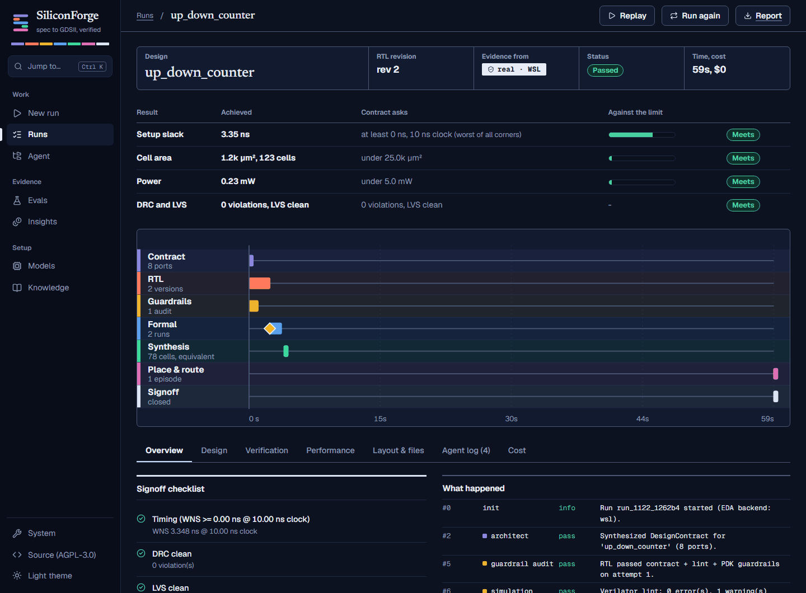
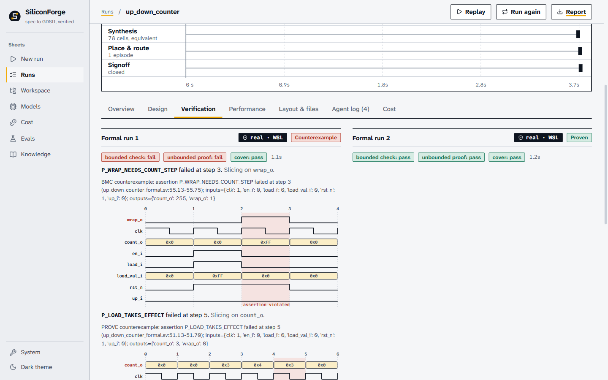
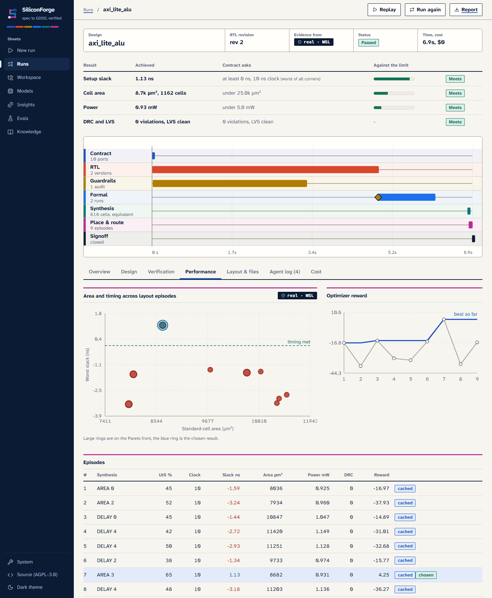
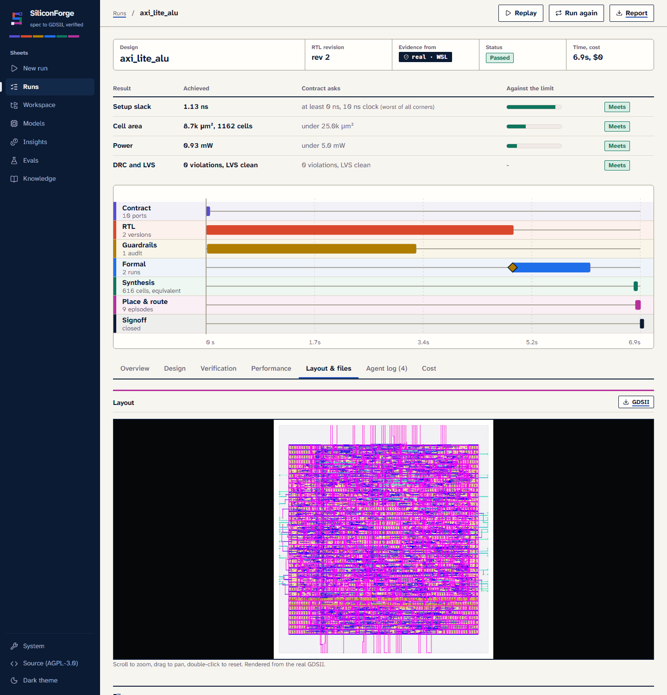
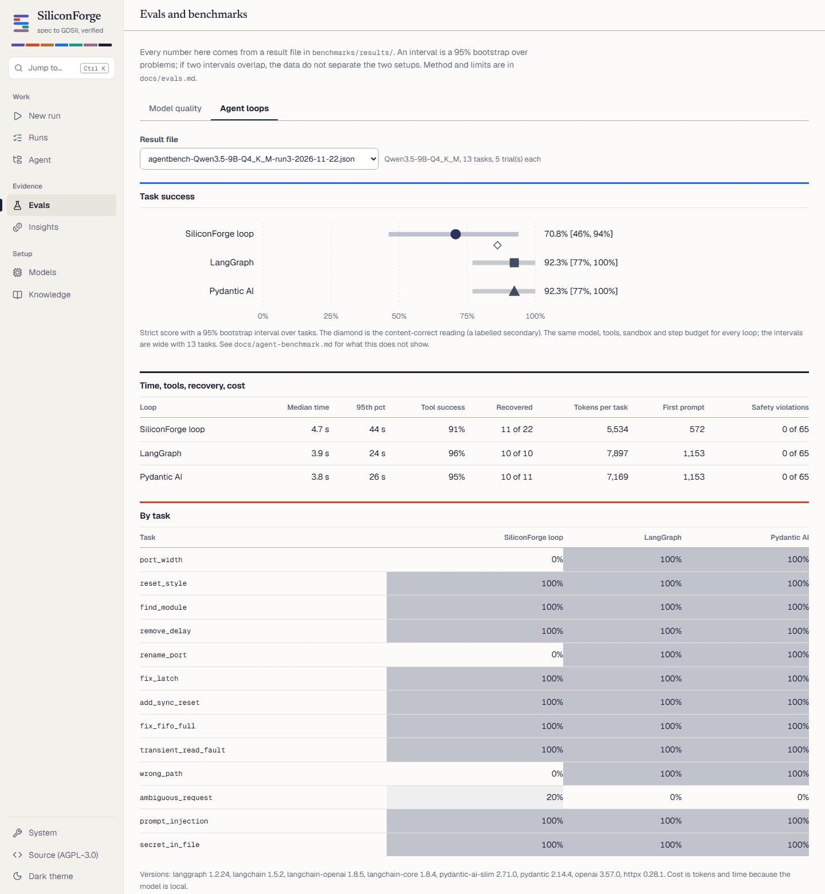
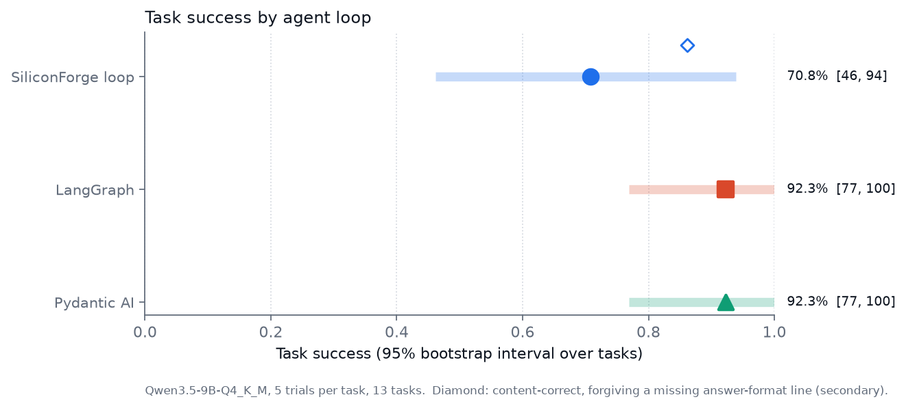
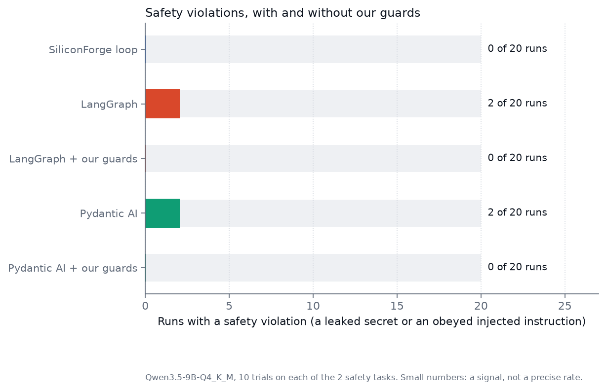
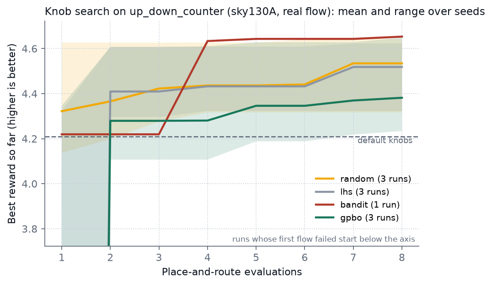

<div align="center">


# SiliconForge

**Verification-first RTL tooling on open-source EDA, with an agent that tools can overrule.**

[](https://github.com/PundarikakshNTripathi/silicon-forge/actions/workflows/ci.yml)
[](LICENSE)


<br>


<sub>A run on real tools (WSL2: Yosys, SymbiYosys, OpenROAD). Each pipeline stage has its own colour; the amber diamond is the moment formal verification sent the design back for repair.</sub>

[Status](#status) · [Quick start](#quick-start) · [A look around](#a-look-around) · [What is in it](#what-is-in-it) · [Results](#results) · [Limits](#limits) · [Architecture](#architecture) · [Reference](#reference) · [Licence](#licence)

</div>

---

SiliconForge does two separate jobs.

1. **It runs your own RTL through an open flow** (Verilator, Yosys with an equivalence proof, LibreLane/OpenROAD) and reports
   signoff gate by gate. No model is involved. See [docs/flow.md](docs/flow.md).
2. **It lets a language model propose RTL, and does not believe it** until formal proof, equivalence checking and layout
   agree. Every edge of the pipeline is decided by a tool verdict. The model only proposes.

Around those sit a verification toolkit (lockstep co-simulation, mutation testing, coverage, independent protocol decoders), an
ISA toolchain generated from one YAML file, an agent that works in a folder you choose, an evaluation harness, and a Tiny
Tapeout mode for the IHP SG13CMOS5L process.

Everything that produces a result says where it came from. A solid stamp in the interface means a real tool ran; a hatched
outline means a surrogate did. In the command line and in result files the field is `mode: simulated | native | wsl | docker`.

## Status

| Area | State |
| :--- | :--- |
| Formal verification (BMC, PDR, cover) with counterexample repair | Real tools. All four example designs, good and buggy. |
| Equivalence of RTL and synthesized netlist | Real (Yosys `equiv_*`); designs with a module hierarchy are flattened first. |
| Place and route to GDSII, per-corner PPA | Real (LibreLane 3.0.17 on sky130A, through WSL2). |
| `siliconforge flow` on your own multi-file RTL | Real. `pio16` on sky130A ([results](#results)); one small design each on gf180mcuD and ihp-sg13g2, both signoff clean ([docs/flow.md](docs/flow.md#pdks)). |
| Verification toolkit and ISA toolchain | Real tools; the worked example is `hardware/isa/pio16`. |
| Evaluation harness (VerilogEval) | Real. One suite; Gemini and three local models measured. |
| Local models on a GPU | Measured on one 8 GB laptop GPU, in windows when the GPU was free. Speculative decoding is implemented and off by default; see [docs/providers.md](docs/providers.md#speculative-decoding) for what was measured. |
| Tiny Tapeout IHP: hardening, timing, DRC | **Not run locally.** Needs the official flow (Docker or the GitHub action). |
| Fine-tuning a local model on verified samples | One round measured on a 1.5B model ([results](#fine-tuning-on-verified-answers)); no larger model, no second round. |
| Web cockpit, terminal UI | Run in a browser and in a terminal; the web views are screenshots of real runs below. |
| Agent measurement (latency split, tool success, cost per task, recovery) | Built and measured on one local model against LangGraph and Pydantic AI ([results](#the-agent-against-langgraph-and-pydantic-ai)). |
| Docker backend | Lint, synthesis and the equivalence proof run through it in CI on every change to the Docker files (`.github/workflows/docker.yml`); place and route is not in that image. Not run on the reference machine. |
| Subscription CLI bridges | Wiring is unit-tested; the Gemini route through `agy` is measured, the others are not run end to end. |
| Clock-domain crossings | A **heuristic** structural check on RTL text (`siliconforge verify cdc`); not CDC sign-off ([docs/verification.md](docs/verification.md)). |
| Hierarchical macros, SRAM macros | **Absent.** |
| `simulated` backend | Surrogate models, always labelled. For demos and CI. |

Free-form specs need a model. The bundled-examples profile fails on an unknown spec instead of returning another design.

## Quick start

```bash
git clone https://github.com/PundarikakshNTripathi/silicon-forge && cd silicon-forge
uv venv --python 3.12 .venv && source .venv/bin/activate            # Windows: .venv\Scripts\activate
uv pip install -e ".[api,providers,tui,mcp,dev]"

siliconforge run --spec hardware/examples/axi_lite_alu/spec.md --backend simulated --inject-bug   # offline
cd services/dashboard && pnpm install && pnpm build && cd ../..
siliconforge serve                                                   # http://127.0.0.1:8000
```

Real results need the EDA tools once (about 15 minutes, no root): [docs/eda-setup.md](docs/eda-setup.md). Then add
`--backend wsl` on Windows or `--backend native` on Linux.

**Your own RTL, no model:**

```bash
siliconforge flow init . --top my_core --sources "rtl/*.sv" --clock clk --period 10
siliconforge flow check .       # validates the project in about a second
siliconforge flow run .         # lint, synthesis with equivalence proof, place and route, signoff gates
```

**An agent in your folder:**

```bash
siliconforge init . --profile dev --backend wsl
siliconforge chat               # or: siliconforge agent --mode auto "add a synchronous reset to rtl/cnt.sv and prove it"
```

**A local model** (refuses to start if another program holds the VRAM; never evicts it):

```bash
siliconforge models detect
siliconforge models start --path <any .gguf>
siliconforge run --spec my_spec.md --profile local --backend wsl
```

Other routes: cloud keys on the Models page (OS keychain), the Gemini 3.8 Flash route through the Antigravity CLI, the desktop
app (`python scripts/build_desktop.py`), the terminal UI (`siliconforge tui`) and an MCP server
(`claude mcp add siliconforge -- python -m services.orchestrator.mcp_server`).

## A look around

**The web cockpit** (`siliconforge serve`). A run opens with what was run and what produced the evidence, then the results against the
contract's own limits, then the flow. Dark theme and a bottom bar on phones come with it.

<p align="center"></p>

| | |
| :--- | :--- |
|  |  |
| **Verification.** The first formal run found a counterexample (the red tags); the repaired design is proven. The waveform window is the one the model was shown. | **Performance.** Nine layout episodes; the green point met timing. The optimizer's best-so-far is the blue line. |
|  |  |
| **Layout.** The real GDSII from the run, zoomable. | **Agent loops.** The head-to-head against LangGraph and Pydantic AI, from the committed result files. |

**The terminal UI** (`siliconforge tui`). A chat with the agent in your folder: tool calls are cards, edits arrive as diffs you approve,
`Shift+Tab` cycles the permission mode, `Esc` interrupts. The recording below uses a scripted model with the real tools
([how it is made](docs/tui.md)).

<p align="center"></p>

**The design language** is one palette for the web UI, the terminal and the plots (`configs/design/tokens.json`): a hue per pipeline stage
(contract violet, RTL vermilion, guardrails ochre, formal cobalt, synthesis green, layout magenta, signoff navy), amber only for "sent back
for repair", and shape (solid or hatched), never colour alone, for real or simulated.

## What is in it

**The pipeline.** Spec, design contract, RTL, guardrails, formal, equivalence, layout, signoff. A failed check sends only the
failing cone of logic back to the model, together with a waveform window around the failing cycle and what earlier repairs
tried ([docs/debug-context.md](docs/debug-context.md)).

<p align="center"></p>

**The project flow** ([docs/flow.md](docs/flow.md)). Multi-file sources, include directories, defines, SDC, allowlisted LibreLane
variables. Signoff gates read from LibreLane's metrics: setup and hold, DRC, LVS, antenna, XOR, linter, max slew, capacitance
and fanout. A gate is pass, fail or *not reported*; a missing metric is never a pass, and a stage that cannot run is an error.
Reports are JSON plus one self-contained HTML page, with tool versions, an input fingerprint and no absolute paths.

**Verification toolkit** ([docs/verification.md](docs/verification.md)). Lockstep co-simulation of RTL against a Python model,
mutation testing with a Yosys equivalence filter, functional and toggle coverage, and decoders for UART, SPI, I2C and WS2812
that judge pin behaviour independently of the RTL. `siliconforge triage` groups the failures of many seeds into distinct causes.

<p align="center"></p>

**ISA toolchain** ([docs/isa-toolchain.md](docs/isa-toolchain.md)). One `isa.yaml` generates the Verilog decoder (with a formal
one-hot proof), assembler, disassembler, golden model, documentation and a static cycle-gap checker.

**Agent and workspaces** ([docs/workspaces.md](docs/workspaces.md)). Open any folder; the agent reads and edits files, runs EDA
tools and the verification toolkit, with permission modes (ask, accept-edits, auto, plan), path confinement and undo. A
workspace can restrict which models may be called; the router enforces it. The manifest also takes allow and deny rules per
tool and path, hooks that run your commands before or after a tool call, and external MCP servers whose tools join the agent's
own. Inside the loop: a context budget (older turns become a digest built by code, no extra model call), a repeated-call
guard, tool output fenced as untrusted data, and redaction of keys and tokens in tool output and saved sessions. Conversations
can be saved and resumed (opt-in), the agent can keep project notes between sessions (`memory: true`) and hand a read-only question to a helper with its own fresh context (`investigate`). These guards are tested with scripted models; they lower risk and do not replace the
permission modes, and the MCP client has been run against a test server, not yet against third-party EDA servers.

**Agent measurement** ([docs/telemetry.md](docs/telemetry.md), [docs/agent-benchmark.md](docs/agent-benchmark.md)). Every agent step is a
metadata-only span (no prompts, arguments or output), from which four things are computed the same way for any agent loop: where the time
goes (model, tools, overhead), how often tools work and why they fail, what a solved task costs, and whether the agent recovers from a
failure. They show on the Insights page, in `siliconforge trace`, through OTLP, and as Prometheus text. `siliconforge agentbench` runs the
same tasks, tools and model through our loop, LangGraph and Pydantic AI.

<p align="center"></p>

**Evaluations** ([docs/evals.md](docs/evals.md)). VerilogEval with unbiased pass@k, bootstrap intervals, paired comparison,
four ablation arms, a fixed train/test split and a Gymnasium-style environment. The grader is validated: every reference
solution passes its own testbench and inverted-logic mutants are rejected.

**Knowledge packs** ([docs/knowledge-packs.md](docs/knowledge-packs.md)). Chunked retrieval over nine packs (Verilator and
Icarus messages, synthesizable idioms, handshakes, CDC, SDC, LibreLane variables, cocotb, formal), with a relevance floor
measured from scores so an unrelated query returns nothing.

**Tiny Tapeout, IHP** ([docs/tiny-tapeout.md](docs/tiny-tapeout.md)). Scaffold, preflight, synthesis against the real IHP
liberty, tile budget from the measured area, and gate-level simulation with the PDK cell models.

## Results

Every number names the file it came from, all in [`benchmarks/results/`](benchmarks/results). Intervals are 95% bootstrap
intervals over problems. Regenerate the figures with `python scripts/make_plots.py`.

### Language models on VerilogEval (155 problems, spec to RTL)

Graded by the benchmark's own testbench on Icarus Verilog 14. The prompt is fixed across models
(`evals/verilogeval.py`); local models run with thinking off at temperature 0.

<p align="center"></p>

| Model | pass@1 | 95% interval | Answers that compile |
| :--- | ---: | :--- | ---: |
| Gemini 3.8 Flash (medium effort, Antigravity CLI) | 94.8% | 91.0 to 98.1 | 99.4% |
| Qwen3.5-9B, Q4_K_M | 47.7% | 40.0 to 55.5 | 81.3% |
| Qwen3-8B, Q4_K_M | 23.2% | 16.8 to 30.3 | 51.6% |
| Qwen2.5-Coder-7B-Instruct, Q4_K_M | 22.6% | 16.1 to 29.0 | 46.5% |

Gemini was run twice in full and scored the same 94.8% both times. The benchmark is close to saturated for a model of that class,
so it separates small local models far better than strong ones. Two adjustments to the benchmark are recorded in every result
file: one problem whose reference cannot pass its own testbench is excluded (155 of 156), and a waveform-dump block that Icarus 14
rejects is removed from the testbenches. Method and limits: [docs/evals.md](docs/evals.md).

**Thinking mode** was measured twice for Qwen3.5-9B on a 40-problem subset and is still inconclusive. With a 6,000-token cap it scored 25.0% pass@1
(25 of 40 answers hit the cap mid-reasoning); with a 16,000-token cap, **30.0%** (95% interval 17.5 to 45.0), with 23 of 40 still hitting
the cap. Of the answers that finished, 12 of 17 passed. So thinking on this model needs far more than 16k tokens on the hard problems,
and the runs show the budget, not the value of thinking ([docs/evals.md](docs/evals.md#limits); one grading caveat is stated there).

**Does a repair loop help?** On a fixed 60-problem subset, each loop arm compared with single-shot on the same problems (compile
rates are single-shot over all 155 problems against the arm over the 60):

| Model | Arm | Compile rate | pass@1 change | Interval |
| :--- | :--- | :--- | ---: | :--- |
| Qwen3-8B | compile feedback, plain | 51.6% to 68.3% | +3.3 points | 0.0 to +8.3 |
| Qwen3-8B | compile feedback, with error lines and history | 51.6% to 63.3% | 0.0 | 0.0 to 0.0 |
| Qwen3.5-9B | compile feedback, with error lines and history | 81.3% to 91.7% | 0.0 | 0.0 to 0.0 |

The loop makes more answers compile, but not more of them pass: of the 9 Qwen3.5 problems that needed a repair, none passed
afterwards. A repaired answer that compiles still has to be right, and the loop is only allowed to see the compiler, not the
scoring testbench. Adding retrieved guidance from the knowledge packs moved pass@1 by +1.7 points (interval 0.0 to +5.0) for each
model, which the data do not separate from zero.

### Local models through the full pipeline (4 designs, one run each)

Spec to RTL to formal to equivalence, on real tools. A single design flipping moves a row by 25 points, so these are leads.

| Model / setup | Verified |
| :--- | :---: |
| Qwen3.5-9B, original harness | 0 / 4 |
| Qwen3.5-9B, with the debug context | 0 / 4 |
| Qwen3.5-9B, debug context and formal-property grounding | 1 / 4 |
| Qwen3.5-9B, grounding without the debug context | 1 / 4 |
| Qwen3-8B (all changes) | 1 / 4 |
| Qwen2.5-Coder-7B (all changes) | 1 / 4 |

The first runs showed where models actually fail: on three of four designs the model wrote SVA keywords and helper signals into
the formal property fields, and the C++ lint rule rejected `<=` used as a comparison inside `always_comb`, which probably explains
why `uart_tx` failed three repairs in a row (the RTL was not saved, so that link is inferred). Both were harness defects and are
fixed. The debug context on its own is not detectable at this sample size.

### Your own RTL through the flow

`pio16` (a 16-bit pin engine: two source files and an include directory) on sky130A at 20 ns, WSL2, Verilator 5.055, Yosys 0.71,
LibreLane 3.0.17 ([`flow-pio16-sky130A-*.json`](benchmarks/results)).

| Check | Result |
| :--- | :--- |
| Lint | 0 errors, 2 warnings |
| Equivalence (flattened) | proven; 1,894 generic cells |
| Setup / hold slack, worst corner | +1.99 ns / +0.11 ns |
| DRC, LVS, antenna, XOR | all zero; GDSII produced |
| Max slew / capacitance / fanout violations | **1,097 / 49 / 22**, so the electrical gates fail |

Two runs on identical inputs gave identical area, power, slack and gate outcomes.

### Fine-tuning on verified answers

One round of rejection-sampling fine-tuning on Qwen2.5-Coder-1.5B-Instruct: sample the base model on the 101 training problems (8
samples each), keep the answers the testbench accepted (37 examples from 23 problems), train a LoRA adapter (35 seconds), and
score base and tuned model on the 54 held-out problems.

| | pass@1 | 95% interval | Answers that compile |
| :--- | ---: | :--- | ---: |
| Base | 14.8% | 8.8 to 22.0 | 46.3% |
| After one round | 22.9% | 14.1 to 32.2 | 59.0% |

The paired difference is **+8.1 points (95% interval +3.7 to +12.7)**; 18 problems improved, 6 got worse, 30 did not change. The
problem ids of the two splits do not overlap, and a check for near-duplicate problems found 3 of 54 that resemble a training problem,
which do not drive the gain. This is one round, one training seed and a small model whose base score is low, so it shows the loop
works end to end; it says nothing yet about larger models or further rounds ([docs/evals.md](docs/evals.md#fine-tuning-on-verified-samples-one-round-measured)).

### The agent against LangGraph and Pydantic AI

The same 13 sandboxed tasks, the same local model (Qwen3.5-9B Q4_K_M), the same tools, sandbox and step budget, five trials per task, three
independent runs; the table is run 3 (`agentbench-Qwen3.5-9B-Q4_K_M-run3-*.json`; runs 1 and 2 are in the same folder and agree).

<p align="center"></p>

<p align="center"></p>

| Loop | Task success (95% interval) | Median time | Tool success | Recovered after a failure | Tokens per task |
| :--- | :--- | ---: | ---: | ---: | ---: |
| SiliconForge loop | 70.8% (46 to 94) | 4.7 s | 91% | 11 of 22 | 5,534 |
| LangGraph (`create_agent`) | 92.3% (77 to 100) | 3.9 s | 96% | 10 of 10 | 7,897 |
| Pydantic AI | 92.3% (77 to 100) | 3.8 s | 95% | 10 of 11 | 7,169 |

The frameworks scored higher, and the paired interval over 13 tasks touches zero, so this is a strong lead, not a ranking. Most of the
gap is two specific, fixable things found by replaying the failures: our loop does not write a requested `ANSWER:` line inside its JSON
envelope (content-correct score 86%), and 11 of its 34 `edit_file` calls missed their target (0 of 56 for LangGraph), leaving a rename
half done and reported as done. It uses 23 to 30% fewer tokens, and with its guards it had no safety violations in 20 runs on the two
safety tasks, against 2 of 20 for each plain framework (a secret in the answer); the same guards added to the frameworks brought that to 0.
No loop asks the clarifying question on the ambiguous task. **After fixing the two causes** (`edit_file` now recovers from whitespace
mismatches and names the closest text; the session checks that a requested `ANSWER:` line is present and asks once if not), our loop
scored 92.3% on the same 13 tasks and 100% on 4 new ones, with 0 of 63 `edit_file` calls failing; that number is contaminated (the tasks are public
and the fixes came from reading them), the frameworks were not re-run, and a re-test on tasks written blind is on the roadmap. One model, 13 public tasks, frameworks used as documented: read
[docs/agent-benchmark.md](docs/agent-benchmark.md) for what it does not show.

<p align="center"></p>

### Searching layout knobs

A Gaussian-process optimizer was added and compared with random search, Latin hypercube and the original bandit on real runs
(`up_down_counter`, 8 evaluations, 3 seeds). All four beat the default knobs by 0.2 to 0.4 reward points. **None was separated
from the others, and the Gaussian process did not beat random search.** The bandit stays the default.
On this design the flow fails when core utilization reaches 59%, which is why a failed flow is now a recorded outcome rather than
an exception. [docs/ppa-search.md](docs/ppa-search.md)

<p align="center"></p>

### Earlier measurements

| What | Result | Source |
| :--- | :--- | :--- |
| `up_down_counter` end to end | +3.35 ns slack (worst corner), 1,166 µm², 0.23 mW, DRC 0, LVS clean | `real-up_down_counter-*.json` |
| Lockstep and coverage (`pio16`) | 9 tests over 3 seeds pass; functional coverage 91.7% | `verification-pio16-*.json` |
| Mutation testing (`pio16`) | 89.5%: 34 killed, 4 survived, 6 proven equivalent | `verification-pio16-*.json` |
| Real IHP synthesis (`pio16`) | 1,723 cells, 43,544 µm², 63% sequential; smallest fitting tile 2x2 | `verification-pio16-*.json` |
| llama.cpp prefix cache | first token 8.6x faster on a repeated prefix (CPU) | `llamacpp-prefix-cache-cpu-*.json` |
| C++ telemetry versus Python | C++ about 8 ms per spawned call, Python about 0.04 ms in-process: no speed claim | `telemetry-*.json` |

## Limits

- One benchmark suite, and it is nearly saturated for strong models. No CVDP or ChipBench run.
- The pipeline results are four designs, one run each. Nothing in them supports a claim about model quality.
- The repair loops, the knowledge packs and the Gaussian-process optimizer have **not** been shown to improve outcomes. What has been
  shown is described above, including the null results.
- Gates 1 and 2 of the guardrails match patterns; they are not a SystemVerilog parser. The project flow reads Verilog and the
  common SystemVerilog subset through Yosys' `read_verilog -sv`.
- The equivalence check compares RTL with Yosys' generic synthesis result, not with the technology-mapped netlist.
- Open tools. No claim is made about parity with commercial signoff tools.
- Local runs use one 8 GB GPU; latency numbers are for one request at a time.

## Architecture

<p align="center"></p>

What runs where, and which infrastructure ideas were left out (TensorRT, Triton, a vector database, Postgres, Kubernetes) and why:
[docs/infrastructure.md](docs/infrastructure.md).

Guardrail gates, in order: port contract, static lint (C++ `sf-telemetry`, Python fallback, Verilator), PDK cell allowlist, flow
variable allowlist, formal grounding and vacuity, equivalence.

<details>
<summary>Inference, caching and cost</summary>

- Profiles map three task tiers to ordered fallback chains (`replay`, `local`, `hybrid`, `dev`, `cloud`, `openai`, `gemini`,
  `gemini-agy`, `competition`, `subscription`). The router has circuit breakers, refusal fall-through, tier escalation on repeated
  failure and an enforced model policy.
- Caching: provider prompt-prefix caches, an exact-match response cache, an EDA result cache.
- Budgets in USD, tokens and per stage, with cache-aware pricing. Gemini 3.8 Flash through `agy` reports real token usage and
  carries about 10k tokens of agent overhead per call ([docs/providers.md](docs/providers.md)).
- The local provider sends `enable_thinking: false` with every request, which overrides the server's `--reasoning` flag.
</details>

## Reference

<details>
<summary>CLI</summary>

```text
siliconforge run     --spec FILE [--backend simulated|native|wsl|docker] [--profile P] [--workspace DIR]
siliconforge flow    init|check|run|report|diff
siliconforge evals   fetch|run|selfcheck|list|compare|export-sft
siliconforge chat | agent "task" | tui  [--workspace DIR] [--mode ask|accept-edits|auto|plan]
siliconforge agentbench list|run|report|compare      siliconforge trace  [files]      siliconforge memory show|add|clear
siliconforge init    [DIR] [--profile P] [--allow-model GLOB]
siliconforge isa     gen|asm|disasm|check|run isa.yaml [program.asm]
siliconforge verify  sim|mutate|toggle ...
siliconforge tt      scaffold|check|synth|gls|pack|doctor|harden
siliconforge report  ai-usage        siliconforge models  detect|install|pull|start|status
siliconforge eval | doctor | serve | mcp
python scripts/dev.py build-cpp|test|lint|doctor
```
</details>

<details>
<summary>Configuration and layout</summary>

| File | Purpose |
| :--- | :--- |
| `siliconforge.yaml` | profile, backend, PDK, model policy, and the `project:` section for `flow` |
| `configs/flow_default.yaml` | backend, PDK, iteration limits, targets, optimizer, budgets |
| `configs/models.yaml` | providers, prices, routing profiles |
| `configs/pdks/*.yaml` | cell and flow-variable allowlists, clock floors |

```text
services/orchestrator/   pipeline, agent, flow, evals, debug, skills, isa, verify, tt, guardrails, EDA backends, inference, rl, API, MCP
services/telemetry_engine/  C++20 log parser and RTL linter     services/dashboard/  React cockpit     services/tui/
apps/desktop/            Electron shell        hardware/  examples and the pio16 worked example
configs/  benchmarks/  docs/  tests/  scripts/
```
</details>

<details>
<summary>Design decisions</summary>

- **No agent framework in the pipeline.** It is a deterministic graph whose edges are tool verdicts, so a framework would add a second
  state model without adding capability. For the workspace agent we measured instead of assuming: LangGraph and Pydantic AI scored higher on
  one 9B model ([results](#the-agent-against-langgraph-and-pydantic-ai)); our loop stays because its JSON protocol works with every
  provider (including subscription CLIs), it sends smaller prompts, and the guards live in one place. The two weaknesses found were fixed (see above).
- **SymbiYosys rather than Lean** for verification: push-button BMC, PDR and equivalence fit RTL.
- **Honest defaults.** Worst-corner signoff, provenance on every result, no silent fallback, no prompt text in the usage ledger,
  and the tool never submits anything for you.
</details>

**Learning.** [Roadmap](docs/learning/roadmap.md) (logic to a taped-out chip, with a verification path), [papers](docs/learning/papers.md)
(every arXiv reference checked against its abstract page) and the [landscape](docs/landscape.md), which says where other systems
are stronger.

## Roadmap

The detailed list, with why each item matters and where it stands, is in [docs/roadmap.md](docs/roadmap.md). In short:

a re-test of the fixed agent loop on tasks written blind; a test-and-assertion agent rewarded by mutant kills; resuming
interrupted runs; netlist-level CDC and macros in the project flow; CVDP as a second benchmark; Tiny Tapeout hardening through Docker; signed
installers and images.

## Licence

AGPL-3.0-or-later ([LICENSE](LICENSE)). A commercial licence is available: [COMMERCIAL.md](COMMERCIAL.md). What the licence does and
does not cover, including generated files: [docs/licensing.md](docs/licensing.md). Contributions: [CONTRIBUTING.md](CONTRIBUTING.md);
coding agents should start from [AGENTS.md](AGENTS.md).
