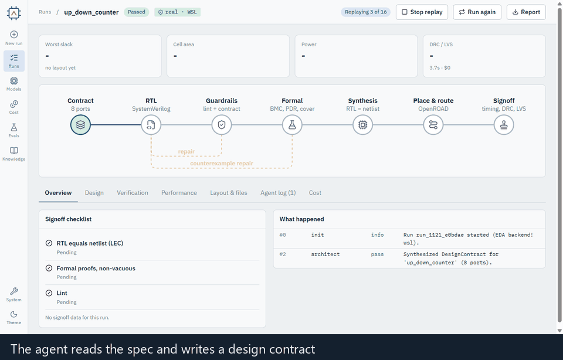
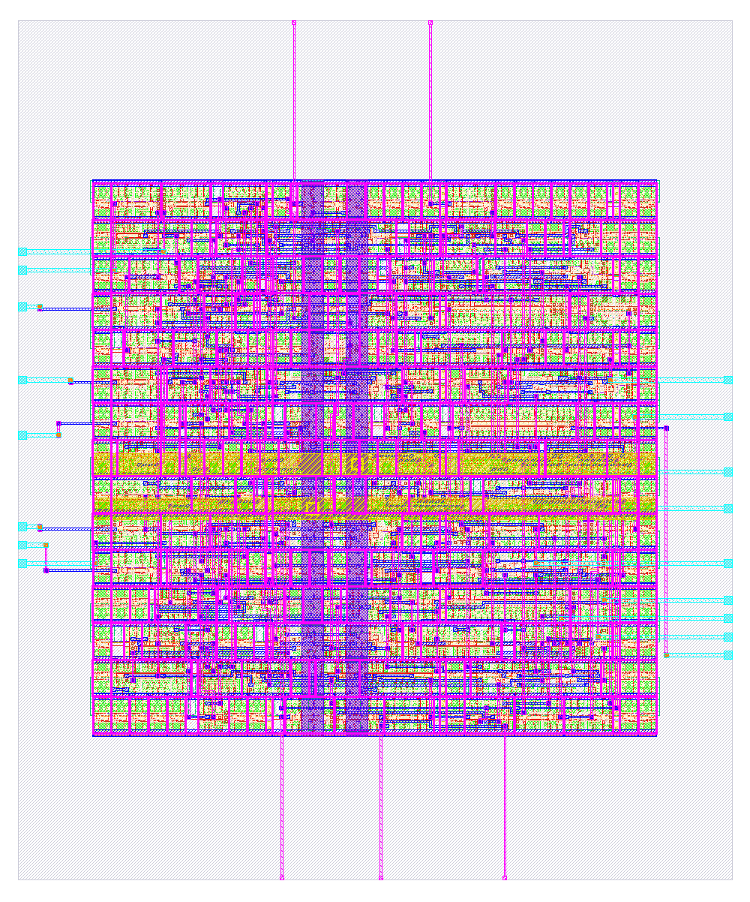
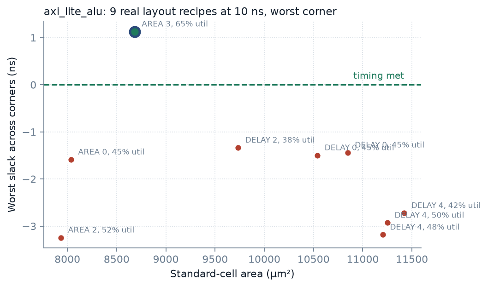
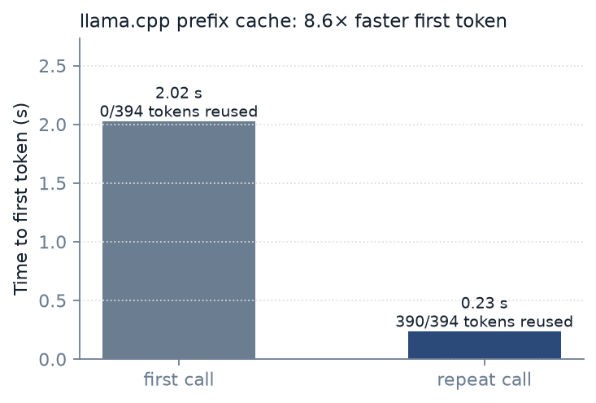
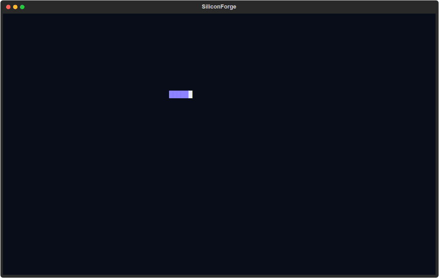
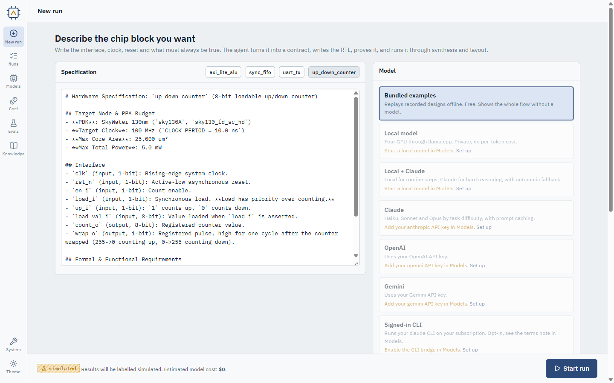
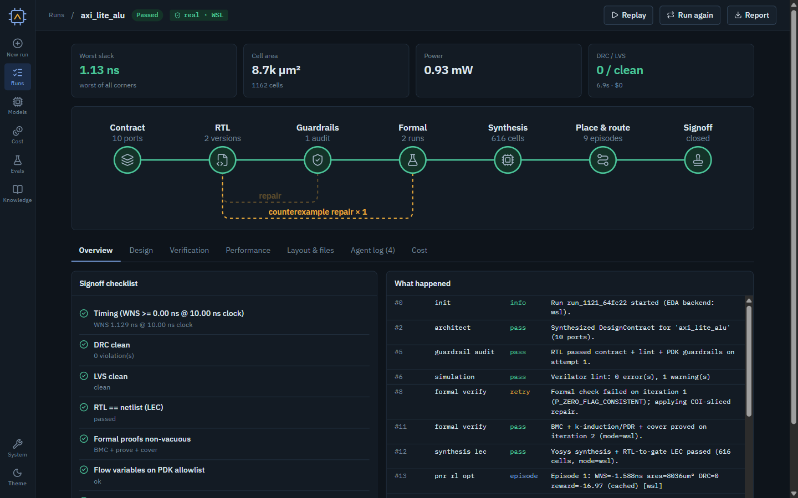
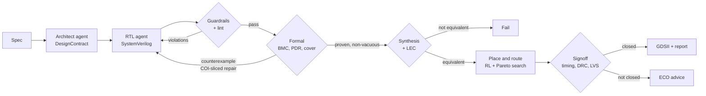
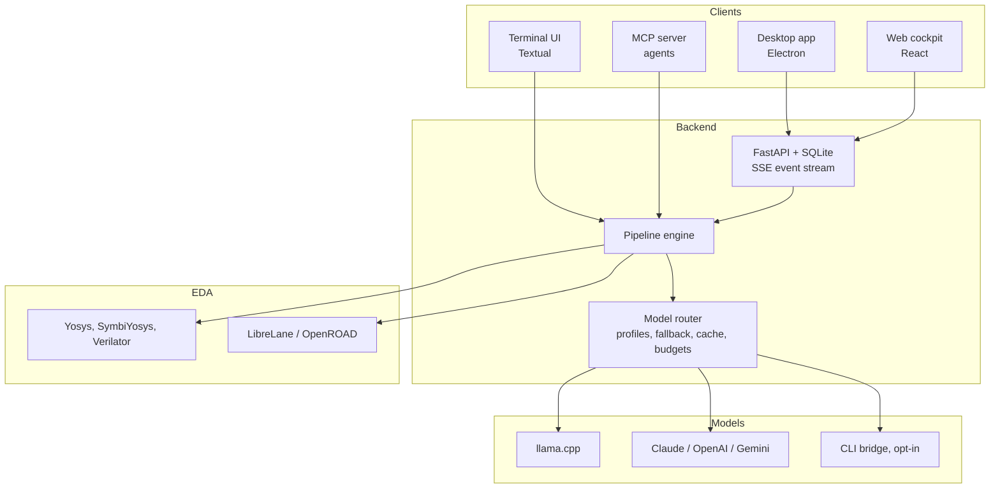

<div align="center">


# SiliconForge

**Describe a chip block. Get RTL that is formally proven, checked for equivalence, and laid out on real open-source EDA.**

An autonomous spec-to-GDSII agent where tools, not language models, decide what passes. Local-first, with a desktop app, web cockpit and terminal UI.

[](https://github.com/PundarikakshNTripathi/silicon-forge/actions/workflows/ci.yml)
[](LICENSE)




</div>

---

## What it does

You write a spec in plain language. SiliconForge turns it into a machine-checked **design contract**, asks a model to write the SystemVerilog, and then refuses to believe it until tools agree:

1. **Guardrails** reject hallucinated ports, cells, flags and unsynthesizable constructs.
2. **SymbiYosys** tries to break the design (bounded check, unbounded proof, and a cover check so proofs cannot pass vacuously). A failure yields a real counterexample waveform.
3. The failing logic is **sliced** out of the RTL and sent back to the model for a minimal repair.
4. **Yosys** proves the synthesized netlist is equivalent to the RTL.
5. **OpenROAD (via LibreLane)** lays it out. A hybrid RL and Pareto optimizer searches recipes across real timing corners.
6. **Signoff** checks timing, DRC, LVS, equivalence and budgets, and writes the GDSII.

Every result is labelled with where it came from. **Hatched amber means simulated; solid green means a real tool produced it.**

## The most impressive parts

**A real bug, found and fixed by real tools.** On the `up_down_counter` example, the first RTL ignores `load` while counting. SymbiYosys produces a counterexample, the cone-of-influence slice goes back to the model, the repaired RTL is proven, Yosys proves equivalence (78 cells), and LibreLane produces a GDSII: worst-corner slack **+3.35 ns**, 1166 µm², 0.23 mW, DRC 0, LVS clean.

<table>
<tr>
<td width="55%"></td>
<td width="45%"></td>
</tr>
<tr>
<td><sub>The counterexample SymbiYosys produced, with the violated cycle shaded.</sub></td>
<td><sub>The layout LibreLane produced (rendered from the real GDSII).</sub></td>
</tr>
</table>

**It signs off on the corner that actually matters, and searches for a layout that survives it.** The 32-bit `axi_lite_alu` meets 10 ns at the typical corner with almost any recipe, but **8 of 9 layout recipes miss it at the slow corner (by 1.3 to 3.2 ns)**. SiliconForge signs off on the worst corner by default; its optimizer found the one recipe that closes everywhere (`AREA 3`, 65% utilization, a counter-intuitive pick over the `DELAY` strategies), after which all 8 signoff checks passed on real tools: slack **+1.13 ns**, 8682 µm², 0.93 mW, DRC 0, LVS clean, equivalence proven.

<table>
<tr>
<td width="50%"></td>
<td width="50%"></td>
</tr>
</table>

**Local-first inference, measured.** With llama.cpp's prefix cache a repeated 394-token prompt reused 390 tokens and its first token arrived **8.6x sooner**. Prompts are laid out with stable content first so provider caches hit too, and spend is capped per run, per stage and per call.



**It admits what it measured.** The C++ telemetry engine costs about 8 ms per call when spawned and in-process Python regex costs about 0.04 ms, so the README does not claim native speed (see [Benchmarks](#benchmarks)).

## What is real and what is simulated

| Capability | Status |
| :--- | :--- |
| Formal verification (BMC, PDR proof, cover), counterexample traces | **Real**: SymbiYosys + Bitwuzla, tested on all 4 example designs, good and buggy |
| Logical equivalence (RTL vs synthesized netlist) | **Real**: Yosys `equiv_*` (FSM re-encoding disabled so name matching holds) |
| Lint | **Real**: Verilator plus the C++/Python rule set |
| Place and route, GDSII, per-corner PPA | **Real**: LibreLane 3.0 / OpenROAD on Sky130, WSL2 or native |
| Model inference | **Real**: llama.cpp, Claude (official SDK), OpenAI-compatible, Gemini |
| Bundled-example replay | Recorded fixtures: the model step is replayed, but the EDA steps are real when you pick a real backend |
| `simulated` backend | **Surrogate models**, always labelled. For demos and CI only |
| Docker backend | Wiring is unit-tested; not run end to end on the reference machine |
| Subscription CLI bridge | Wiring is unit-tested; opt-in, see [terms note](docs/providers.md#subscription-cli-bridge-opt-in) |
| GPU benchmark of local models | Pending: see [Benchmarks](#benchmarks) |

Free-form specs need a model. The bundled-examples profile deliberately fails on unknown specs rather than returning someone else's design.

## Quickstart

```bash
# 1. Install (Python 3.11+, uv recommended)
git clone https://github.com/PundarikakshNTripathi/silicon-forge && cd silicon-forge
uv venv --python 3.12 .venv && source .venv/bin/activate          # Windows: .venv\Scripts\activate
uv pip install -e ".[api,providers,tui,mcp,dev]"

# 2. Run a bundled design end to end (offline, free, simulated EDA)
siliconforge run --spec hardware/examples/axi_lite_alu/spec.md --backend simulated --inject-bug

# 3. Open the cockpit
cd services/dashboard && pnpm install && pnpm build && cd ../..
siliconforge serve            # http://127.0.0.1:8000
```

For real results install the EDA tools once (about 15 minutes, no root needed): see [docs/eda-setup.md](docs/eda-setup.md), then add `--backend wsl` (Windows) or `--backend native`.

## Tutorials

<details open>
<summary><b>1. Watch the agent catch and fix a bug (offline)</b></summary>

```bash
siliconforge run --spec hardware/examples/up_down_counter/spec.md --backend simulated --inject-bug
```
You will see a formal counterexample, a repair, and a passing second proof. In the cockpit, open the run and press **Replay**.
</details>

<details>
<summary><b>2. Real EDA</b> (Windows with WSL2, or Linux/macOS)</summary>

Follow [docs/eda-setup.md](docs/eda-setup.md), then:
```bash
siliconforge doctor                      # shows which backends are ready
siliconforge run --spec hardware/examples/up_down_counter/spec.md --backend wsl --inject-bug
python scripts/verify_examples.py --backend wsl --lec     # proves good RTL, catches every injected bug
```
</details>

<details>
<summary><b>3. A local model on your GPU</b></summary>

```bash
siliconforge models install
siliconforge models pull --repo unsloth/Qwen3.5-9B-GGUF --file Qwen3.5-9B-Q4_K_M.gguf
siliconforge models start --file Qwen3.5-9B-Q4_K_M.gguf
siliconforge run --spec my_spec.md --profile local --backend wsl
```
Or use the **Models** page in the cockpit. Details: [docs/providers.md](docs/providers.md).
</details>

<details>
<summary><b>4. Claude, OpenAI, Gemini, or a subscription you already have</b></summary>

Save a key on the **Models** page (stored in your OS keychain) or set `ANTHROPIC_API_KEY` / `OPENAI_API_KEY` / `GEMINI_API_KEY`, then choose `--profile cloud | openai | gemini | hybrid`. The `subscription` profile drives your signed-in `claude`/`codex`/`gemini` CLI and is **off by default** with a terms note in [docs/providers.md](docs/providers.md).
</details>

<details>
<summary><b>5. Desktop app</b></summary>

```bash
python scripts/build_desktop.py          # UI + C++ engine + frozen backend + Electron installer
apps/desktop/dist/win-unpacked/SiliconForge.exe
```
The shell starts a private backend on a random localhost port with a per-launch token. Tray icon, menus and `siliconforge://runs/<id>` links included.
</details>

<details>
<summary><b>6. Terminal UI</b></summary>

```bash
siliconforge tui
```

</details>

<details>
<summary><b>7. Use it from Claude Code, Codex, opencode and other agents</b></summary>

SiliconForge ships an MCP server and agent harness files (`AGENTS.md`, `CLAUDE.md`, `GEMINI.md`, `opencode.json`, shared skills in `.agents/skills`).
```bash
claude mcp add siliconforge -- python -m services.orchestrator.mcp_server
```
Tools: `lint_rtl`, `verify_rtl`, `check_equivalence`, `retrieve_skill`, `list_examples`, `run_example`.
</details>

## The cockpit

| New run | Run overview (real) |
| :--- | :--- |
|  |  |
| **Performance** | **Dark theme** |
|  |  |

Pages: **New run** (model readiness and cost estimate, backend choice, targets), **Runs**, **Run detail** (overview, design with RTL diffs, verification waveforms, performance, layout and files, agent log of every prompt and response, cost), **Models and providers**, **Cost**, **Evals**, **Knowledge packs**, **Toolchain and settings**, and a command palette (Ctrl/Cmd+K).

---

## Table of contents

- [Architecture](#architecture)
- [Guardrail gates](#guardrail-gates)
- [Formal verification loop](#formal-verification-loop)
- [Place and route and PPA optimization](#place-and-route-and-ppa-optimization)
- [Inference, caching and cost](#inference-caching-and-cost)
- [EDA backends and provenance](#eda-backends-and-provenance)
- [Benchmarks](#benchmarks)
- [Configuration](#configuration)
- [CLI reference](#cli-reference)
- [Repository layout](#repository-layout)
- [Design decisions](#design-decisions)
- [Roadmap](#roadmap)
- [Research foundations](#research-foundations)
- [Contributing](#contributing)

## Architecture





More detail in [ARCHITECTURE.md](ARCHITECTURE.md).

## Guardrail gates

| Gate | Catches | How |
| :--- | :--- | :--- |
| 1 Port contract | missing or renamed ports, wrong directions or widths | contract check against the RTL header |
| 2 Lint | `#delay`, `initial`, blocking/non-blocking misuse, latch risk | C++ `sf-telemetry` (Python fallback) + Verilator |
| 3 PDK cells | invented standard cells | allowlist from `configs/pdks/` |
| 4 Flow variables | made-up LibreLane variables, commercial-tool Tcl, impossible clocks | allowlist validated against the real LibreLane source |
| 5 Formal vacuity | properties on signals that do not exist, unreachable covers | grounding check (also inside expressions) + cover result |
| 6 Equivalence | netlist that differs from the RTL | Yosys `equiv_make/simple/induct` |

Gates 1 and 2 use pattern matching rather than a full SystemVerilog parser (a `pyslang` front end is on the roadmap). Every repair, including those made inside the formal loop, is re-audited.

## Formal verification loop

The formal agent never writes SVA. It emits a **typed property IR** (reset values, invariants, handshake stability, mutual exclusion, combinational equivalence, latency bounds, cover) which a deterministic compiler lowers to assertions. SymbiYosys runs `bmc` (Bitwuzla), `prove` (`abc pdr`) and `cover`. On failure the real VCD is distilled into the failing property, cycle and stimulus, the failing signal's backward cone of influence is sliced out of the RTL, and only that slice is sent back for repair. This follows the contract-first and slicing ideas in [Veri-Sure](https://arxiv.org/abs/2601.19747).

## Place and route and PPA optimization

LibreLane runs the classic flow on Sky130 and the metrics are read from its `metrics.json` (per-corner setup slack, standard-cell area, power, DRC, LVS) alongside the real GDSII and a layout render. A clipped-PPO-style policy with UCB exploration and a Pareto archive chooses among recipes whose keys are real LibreLane variables. Because a layout takes minutes, the optimizer supports parallel episodes, early stopping once signoff closes, an on-disk result cache keyed by hash(RTL, knobs, PDK), and optional relaxed-clock actions that report the fastest clock that closes. Signoff uses the **worst timing corner** by default (`tt`, `ss`, `ff` selectable).

## Inference, caching and cost


- **Profiles** map three task tiers (routine, balanced, hard reasoning) to ordered fallback chains: `replay`, `local`, `hybrid`, `cloud`, `openai`, `gemini`, `subscription`.
- **Router**: circuit breakers, refusal fall-through, tier escalation on repeated repair failures.
- **Caching, three layers**: provider/server prompt-prefix caches (stable content first), an exact-match persistent response cache for low-temperature calls, and an EDA result cache.
- **Cost control**: pre-run estimate, USD / total-token / per-stage token budgets, cache-aware pricing and savings reporting.
- **Claude specifics**: official SDK, prompt caching, `output_config.effort` per model, no sampling parameters (Claude 5.x rejects them), refusals surfaced.

Details and the subscription-bridge terms note: [docs/providers.md](docs/providers.md).

## EDA backends and provenance

`simulated`, `native`, `wsl`, `docker`. Every result carries its `mode`; a missing tool raises an error instead of silently falling back. Setup guide: [docs/eda-setup.md](docs/eda-setup.md).

## Benchmarks

Every number here comes from a file in [`benchmarks/results/`](benchmarks/results). Charts are regenerated with `python scripts/make_plots.py`.

| What | Result | Source |
| :--- | :--- | :--- |
| Example designs on real tools | good RTL proven + LEC pass; injected bug caught with a counterexample, for all 4 designs | `scripts/verify_examples.py`, `tests/test_real_eda.py` |
| `up_down_counter` end to end (real) | slack +3.35 ns (worst corner), 1166 µm², 0.23 mW, DRC 0, LVS clean | `benchmarks/results/real-up_down_counter-*.json` |
| llama.cpp prefix cache | first token 8.6x faster on a repeated prefix (CPU) | `llamacpp-prefix-cache-cpu-*.json` |
| C++ telemetry vs Python | C++ ~8 ms per spawned call, Python ~0.04 ms in-process | `telemetry-*.json` |
| Local GPU model benchmark | **not yet run**: the GPU was occupied by another process on the reference machine. Three models (Qwen3.5-9B, Qwen2.5-Coder-7B, Qwen3-8B, Q4_K_M) are downloaded and `benchmarks/bench_local_models.py` is ready | |

Reproduce on your machine: `python benchmarks/bench_local_models.py --model models/gguf/<model>.gguf`.

## Configuration

| File | Purpose |
| :--- | :--- |
| `configs/flow_default.yaml` | backend, PDK, iteration limits, targets, optimizer, budgets |
| `configs/models.yaml` | providers, per-model prices (with cache pricing), routing profiles |
| `configs/pdks/*.yaml` | cell and flow-variable allowlists, clock floors |
| `configs/prompts/` | agent system prompts |
| `services/orchestrator/skills/packs/` | knowledge packs retrieved into prompts |

## CLI reference

```text
siliconforge run     --spec FILE [--backend simulated|native|wsl|docker] [--profile P] [--inject-bug]
                     [--episodes N] [--parallel N] [--relax] [--verify-only]
siliconforge eval    [--backend B]        # all bundled examples, writes benchmarks/results
siliconforge doctor                       # toolchain, GPU, backends
siliconforge models  install|pull|start|status
siliconforge serve   [--port 8000]        # API + web UI
siliconforge tui | mcp
python scripts/dev.py build-cpp|test|lint|doctor
```

## Repository layout

```text
services/orchestrator/   pipeline, agents, guardrails, EDA backends, inference, RL, API, MCP
services/telemetry_engine/  C++20 log parser and RTL linter (CMake)
services/dashboard/      React web cockpit
services/tui/            Textual terminal UI
apps/desktop/            Electron shell
configs/  hardware/examples/  benchmarks/  docs/  tests/  scripts/
```

## Design decisions

- **No agent framework (LangGraph, Google ADK, Microsoft Agent Framework).** The pipeline is a deterministic graph whose edges are tool verdicts, not model routing, so a framework would add dependencies and a second state model without adding capability. Checkpointing, event streaming and cancellation are small and live in the pipeline and store. Revisit if open-ended, model-routed sub-agents are added.
- **SymbiYosys over Lean for verification.** Push-button BMC, PDR and equivalence fit RTL. Lean-based RTL proofs (for example Rtl2lean) are a promising research direction but need RTL-to-Lean translation and model-written lemmas, and prove model-level rather than gate-level facts. A Lean track for unbounded arithmetic properties is a possible future addition.
- **Honest defaults.** Worst-corner signoff, provenance on every result, no silent mock fallback.

## Roadmap

- `pyslang`-based port and lint front end
- GPU benchmark of local models and a recommended default
- Persistent telemetry server mode (or bindings) so the native path pays off
- LibreLane inside the Docker backend; mapped-netlist LEC
- Cocotb simulation gate; more example designs and an eval suite against public RTL benchmarks
- Optional Lean 4 research track

## Research foundations

- Typed property IR with vacuity detection and counterexample-guided repair: [Open-Source LLM-Driven Formal Verification: A Multi-Agent Pipeline for RTL Repair](https://arxiv.org/abs/2607.28877). That paper reports modest repair rates (one of six benchmarks reliably), so SiliconForge treats the idea as a guardrail, not a guarantee.
- Contract-aware agents with dependency slicing for minimal patches: [Veri-Sure](https://arxiv.org/abs/2601.19747).
- Open-source flow: [LibreLane](https://github.com/librelane/librelane), [Yosys](https://github.com/YosysHQ/yosys), [SymbiYosys](https://github.com/YosysHQ/sby), [OpenROAD](https://github.com/The-OpenROAD-Project/OpenROAD).
- Lean-based hardware verification (future work): [Rtl2lean](https://arxiv.org/abs/2607.16855).

## Contributing

Team workflow, branch naming and commit style are in [CONTRIBUTING.md](CONTRIBUTING.md). If you use a coding agent, `AGENTS.md` is the single source of truth and the other harness files point to it. Licensed under [Apache-2.0](LICENSE).
