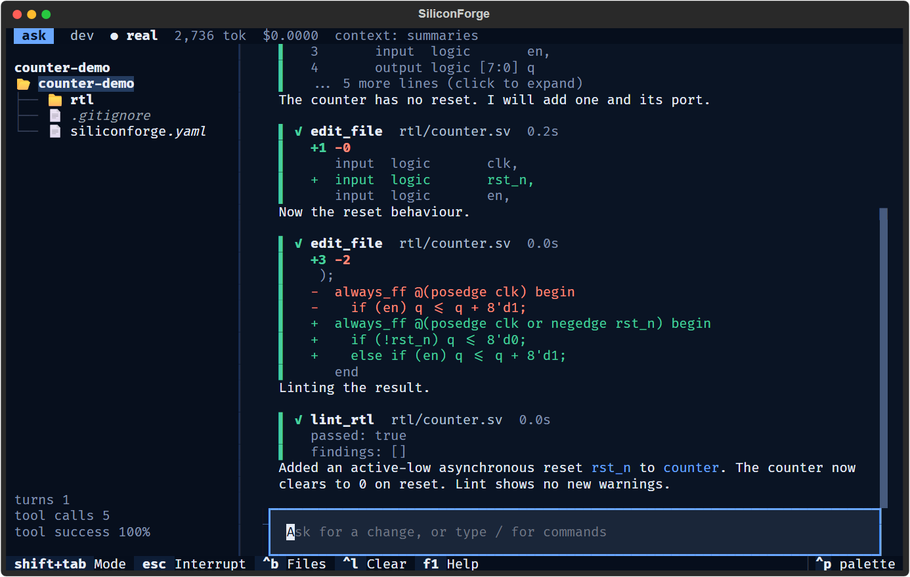
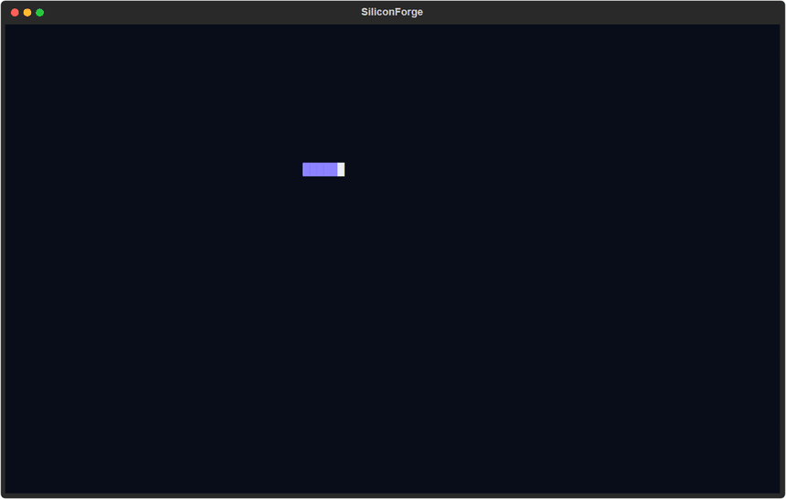

# Terminal UI

`siliconforge tui` opens a chat with the workspace agent in the current folder, in the terminal. It is built with
[Textual](https://textual.textualize.io/) and runs the agent in the same process: the orchestrator is Python, so there is no second
language and no protocol between the UI and the agent. (Ratatui and Bubble Tea are good frameworks; using either here would mean a
Rust or Go front end talking to the Python core over IPC, for nothing Textual cannot do.)



```bash
pip install -e ".[tui]"
siliconforge tui                          # chat in this folder
siliconforge tui --mode plan              # read-only: the agent describes changes instead of making them
siliconforge tui --save                   # keep the conversation; later: siliconforge tui --resume
siliconforge tui --run                    # the pipeline run viewer (stage strip, event log) instead of the chat
```



The recording above is a **real session, about a minute long**, with nothing scripted except the keystrokes: `siliconforge tui` runs in a pseudo-terminal
(`scripts/tui_real/server.py`, via `pywinpty`) and is shown in a terminal emulator inside a headless browser (xterm.js), where `rec.cjs` types the request, presses
`y` at the approval prompt and saves a frame about every 100 ms. The model is the local Qwen3.5-9B (`start_llm.py` starts a private server); it read
`rtl/counter.sv`, proposed an edit, waited for approval, applied it, read the file back and answered. The file on disk changed. `make_gif.py` joins the frames
with their real timing (no pause longer than 1.3 s is shortened, and none needed to be). It is not a screen recording of Windows Terminal: the app talks to a
real pseudo-terminal, but the picture comes from a browser-hosted terminal, which made it possible to capture it without taking over the desktop.

To redo it: `cd scripts/tui_real && npm i playwright-core @xterm/xterm && pip install pywinpty websockets`, start the model with `start_llm.py`, the pty
server with `server.py PORT WORKSPACE REPO tui --workspace WORKSPACE --profile local`, then `node rec.cjs PORT OUT "your request"` and `make_gif.py`. One run is
one take; the result depends on what the model does that time. The older scripted frames (`scripts/tui_demo.py`) remain for tests and screenshots of states that are
hard to reach with a real model.

## What you see

- **Conversation.** Your message, the agent's notes (rendered as Markdown), and one **card per tool call**: a spinner and elapsed time
  while it runs, then a tick or a cross. A card for an edit shows the change as a diff; other cards show a short readable summary of the
  result. Click a card to expand its output.
- **Approvals.** In `ask` mode an edit or a command opens a modal showing what will change (a unified diff for `write_file` and
  `edit_file`, the arguments otherwise). `y` allows it once, `a` allows that tool for the rest of the session, `n` declines.
  Workspace `allow` and `deny` rules in `siliconforge.yaml` apply exactly as in `siliconforge chat`.
- **Status line.** Permission mode, routing profile, a **real** or **simulated** stamp for the workspace's EDA backend, tokens, cost,
  and the context stage (how far the transcript has been compacted). The side panel shows the folder, turns, tool calls and tool success.
- **Splash.** The logo's five layers are deposited one after another. Any key skips it; `--no-anim` removes it.

## Keys and commands

| | |
| :--- | :--- |
| `Shift+Tab` | cycle mode: ask, accept-edits, auto, plan |
| `Esc` | interrupt the turn after the current step |
| `Ctrl+B` / `Ctrl+L` | toggle the file panel / clear the screen |
| `Ctrl+P` | Textual's command palette (themes, screenshot) |
| `/mode`, `/undo`, `/sessions`, `/resume`, `/cost`, `/clear`, `/theme`, `/help`, `/exit` | slash commands, with inline completion |

## Colour

The palette is the same as the web UI's (`configs/design/tokens.json`): one hue per pipeline stage, and amber only for "sent back for
repair". In the chat, tool cards use neutral state colours (running is blue, success green, failure red) so they never borrow a stage
hue. The run viewer's stage strip does use the stage hues, drawn solid for real tools and hatched for a surrogate, with a diamond on
a stage that sent the design back.

## What is not here

- **Token streaming.** The agent's protocol is one JSON object per step, so a streamed reply would be a half-written JSON string; the UI
  shows each note and card as its step completes instead. Streaming becomes useful if the protocol moves to native tool calling.
- **Mouse selection of cards, themes beyond light and dark, and a custom command palette** are not built.

## Tests

`tests/test_tui_chat.py` drives the app headlessly with Textual's Pilot and a scripted model: a question with a tool card, an edit
that is applied only when approved (and shown as a diff first), "always allow", Shift+Tab cycling, slash commands, Esc interrupting a
running turn, input refused while the agent is working, and the splash and stage-strip rendering. `tests/test_agent.py` covers the
session-level interrupt.
