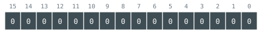
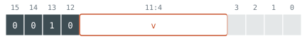
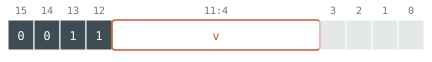
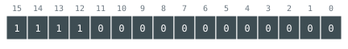

# PIO16 instruction set

A deliberately small 16-bit pin engine used to demonstrate the ISA toolchain: it drives and reads eight pins with cycle-exact timing, has two 8-bit counters and a 5-bit program counter (32 instructions). It is a teaching spec, not a product; copy it as the starting point for your own.

16-bit fixed-width instructions. This document is generated from `isa.yaml`; the assembler, disassembler, Verilog decoder and golden model are generated from the same file.

## Summary

| Instruction | Syntax | Cycles | Pin event | Encoding |
|---|---|---|---|---|
| `nop` | `nop` | 1 |  | `0000000000000000` |
| `ldx` | `ldx {v}` | 1 |  | `0001vvvvvvvv----` |
| `ldy` | `ldy {v}` | 1 |  | `0010vvvvvvvv----` |
| `pins` | `pins {v}` | 1 | yes | `0011vvvvvvvv----` |
| `oe` | `oe {v}` | 1 | yes | `0100vvvvvvvv----` |
| `delay` | `delay {n}` | 1 + n |  | `0101nnnnnnnn----` |
| `jmp` | `jmp {t}` | 1 |  | `0110-------ttttt` |
| `djnz` | `djnz {t}` | 1 |  | `0111-------ttttt` |
| `jpin` | `jpin {p}, {t}` | 1 |  | `1000-ppp---ttttt` |
| `halt` | `halt` | 1 |  | `1111000000000000` |

## State

| Register | Bits | Reset |
|---|---:|---:|
| `pc` | 5 | 0 |
| `x` | 8 | 0 |
| `y` | 8 | 0 |
| `pins` | 8 | 0 |
| `oe` | 8 | 0 |
| `halted` | 1 | 0 |

## Instructions

### `nop`

Do nothing for one cycle.

Syntax: `nop`. Takes 1 cycle(s).

### `ldx`

Load the X counter with an 8-bit constant.

Syntax: `ldx {v}`. Takes 1 cycle(s).
- `v` (8 bits, bits 11:4, uint).

### `ldy`

Load the Y counter with an 8-bit constant.

Syntax: `ldy {v}`. Takes 1 cycle(s).
- `v` (8 bits, bits 11:4, uint).

### `pins`

Drive the eight output pins. This is a pin event for the timing checker.

Syntax: `pins {v}`. Takes 1 cycle(s).
- `v` (8 bits, bits 11:4, uint).

### `oe`

Set the output-enable mask (1 = drive).

Syntax: `oe {v}`. Takes 1 cycle(s).
- `v` (8 bits, bits 11:4, uint).

### `delay`

Wait n extra cycles, so the instruction takes 1 + n cycles in total.

Syntax: `delay {n}`. Takes 1 + n cycle(s).
- `n` (8 bits, bits 11:4, uint).

### `jmp`

Jump to an address.

Syntax: `jmp {t}`. Takes 1 cycle(s).
- `t` (5 bits, bits 4:0, label).
- Control flow: jump.

### `djnz`

Decrement X, then jump if X is not zero. A loop that uses it needs `.bound` for the timing checker.

Syntax: `djnz {t}`. Takes 1 cycle(s).
- `t` (5 bits, bits 4:0, label).
- Control flow: cond.

### `jpin`

Jump if input pin p is high.

Syntax: `jpin {p}, {t}`. Takes 1 cycle(s).
- `p` (3 bits, bits 10:8, uint).
- `t` (5 bits, bits 4:0, label).
- Control flow: cond.

### `halt`

Stop the engine.

Syntax: `halt`. Takes 1 cycle(s).
- Control flow: halt.
